# SDD — SafeRoute

| Campo | Valor |
|---|---|
| Producto | SafeRoute (aplicación móvil) |
| Documento | Software Design Document |
| Versión | 0.2 |
| Estado | Borrador para revisión |
| Fecha | 2026-10-20 |
| Responsable | Darvy |
| Documento de origen | [PRD-SafeRoute.md](../prd/PRD-SafeRoute.md) v0.2 |

### Historial de cambios

| Versión | Fecha | Cambio |
|---|---|---|
| 0.1 | 2026-10-20 | Versión inicial: React Native, .NET, Azure SQL, Azure Service Bus, Google Maps. |
| 0.2 | 2026-10-20 | Rediseño con **Java** y **componentes gratuitos sin costo de licencia**: Android nativo en Java, Spring Boot, PostgreSQL, cola de tareas sobre PostgreSQL, FCM, OpenStreetMap con teselas y geocodificador autoalojados. Se agregan el análisis de licenciamiento (§14) y la guía de ejecución local (§15). iOS sale del alcance del MVP. |

---

## Índice

1. [Introducción](#1-introducción)
2. [Arquitectura general del sistema](#2-arquitectura-general-del-sistema)
3. [Diagramas de componentes](#3-diagramas-de-componentes)
4. [Diseño del backend](#4-diseño-del-backend)
5. [Diseño del frontend móvil](#5-diseño-del-frontend-móvil)
6. [Modelo de datos](#6-modelo-de-datos)
7. [APIs y endpoints](#7-apis-y-endpoints)
8. [Flujo de validación de llegada](#8-flujo-de-validación-de-llegada)
9. [Flujo de verificación cada 20 minutos](#9-flujo-de-verificación-cada-20-minutos)
10. [Manejo de notificaciones](#10-manejo-de-notificaciones)
11. [Mapas y búsqueda de direcciones](#11-mapas-y-búsqueda-de-direcciones)
12. [Decisiones técnicas](#12-decisiones-técnicas)
13. [Dependencias](#13-dependencias)
14. [Análisis de licenciamiento](#14-análisis-de-licenciamiento)
15. [Ejecución en ambiente local](#15-ejecución-en-ambiente-local)
16. [Estándares de desarrollo](#16-estándares-de-desarrollo)
17. [Trazabilidad con el PRD](#17-trazabilidad-con-el-prd)
18. [Riesgos técnicos y preguntas abiertas](#18-riesgos-técnicos-y-preguntas-abiertas)

---

## 1. Introducción

### 1.1 Propósito

Este documento describe el diseño técnico de SafeRoute: arquitectura, componentes, modelo de datos, contratos de API, flujos críticos, análisis de licenciamiento y ejecución local. Es la referencia para el desarrollo, las pruebas y la revisión técnica del MVP.

### 1.2 Alcance

Cubre el MVP del PRD v0.2: la app Android (modos Tutor y Menor), el backend (API y Worker), la base de datos, las notificaciones push, los mapas y la búsqueda de direcciones.

### 1.3 Restricciones de diseño

| ID | Restricción | Origen |
|---|---|---|
| RD-01 | Todo el código propio se escribe en **Java**: backend en Java 25 LTS y app Android en Java (nivel de lenguaje 17). | PRD §3.4 |
| RD-02 | Todo componente es de **código abierto con licencia OSI** o un **servicio gratuito** sin costo de licencia ni de uso en el volumen del MVP. | RNF-LIC-01, RNF-LIC-03 |
| RD-03 | El sistema completo se ejecuta **en local** con contenedores y un emulador Android, sin cuentas de pago. | RNF-OPE-01 |
| RD-04 | Plataforma móvil única: **Android 10+ con Google Play Services**. | PRD §3.3 |

### 1.4 Convenciones del documento

- Los identificadores `RF-xxx`, `RNF-xxx`, `F-xx`, `CU-xx` y `CA-xx` remiten al PRD.
- Las decisiones técnicas se numeran `ADR-xxx` (§12).
- Los diagramas usan Mermaid.
- Todas las horas persistidas están en **UTC** (`timestamptz`). Las horas de un horario de destino se expresan en la zona horaria IANA del destino.

### 1.5 Términos técnicos

| Término | Definición |
|---|---|
| **Sesión de vigilancia** | Instancia concreta de un horario de destino para un menor y una fecha (p. ej., "Escuela, Sofía, 2026-10-21, 07:00–14:00"). Es la unidad sobre la que se evalúan llegada, salida y no llegada. |
| **Evento de dispositivo** | Hecho crudo reportado por el dispositivo del menor: permanencia o salida de geocerca, cambio de permisos, batería, latido. |
| **Evento de seguridad** | Hecho validado por el backend que puede generar notificación: llegada, salida, reingreso, no llegada, alertas de dispositivo. |
| **Tarea** | Unidad de trabajo asíncrona persistida en PostgreSQL y ejecutada por el Worker (db-scheduler), inmediata o programada para una hora futura. |
| **Ciclo de verificación** | Comprobación programada cada 20 minutos durante una sesión de vigilancia activa (§9). |

---

## 2. Arquitectura general del sistema

### 2.1 Visión general

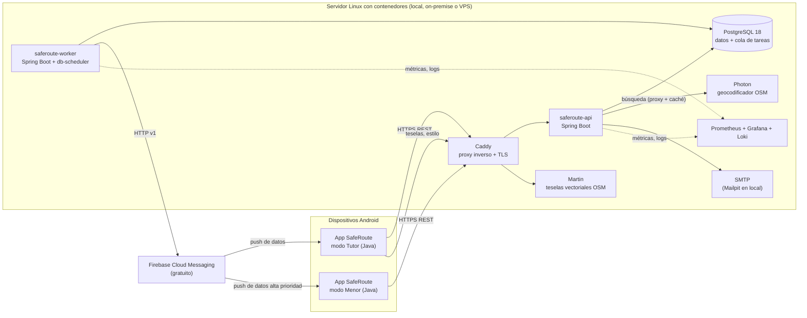

| Componente | Tecnología | Licencia | Responsabilidad |
|---|---|---|---|
| App móvil | Android nativo en Java, Android Views + Material Components | Código propio; dependencias Apache 2.0 / BSD | Modo Tutor y modo Menor en un solo APK. |
| API | Java 25 + Spring Boot 4 | Apache 2.0 | Operaciones de tutores y recepción de eventos de dispositivos. |
| Worker | Java 25 + Spring Boot 4 + db-scheduler | Apache 2.0 | Máquina de estados de las sesiones, temporizadores, verificación cada 20 minutos y despacho de notificaciones. |
| Base de datos | PostgreSQL 18 | PostgreSQL License | Datos transaccionales y cola persistente de tareas. |
| Notificaciones | Firebase Cloud Messaging | Servicio gratuito | Push a tutores y push silencioso al dispositivo del menor. |
| Mapas | MapLibre Native Android + Martin + teselas Protomaps de OpenStreetMap | BSD-2 / Apache 2.0 / datos ODbL | Visualización de mapas sin proveedor comercial. |
| Búsqueda de direcciones | Photon (Java) sobre datos de OpenStreetMap | Apache 2.0 / datos ODbL | Autocompletado y geocodificación inversa. |
| Proxy inverso | Caddy | Apache 2.0 | TLS automático (Let's Encrypt), enrutamiento. |
| Observabilidad | Micrometer, Prometheus, Grafana, Loki | Apache 2.0 / AGPL-3.0 (sin modificar) | Métricas, paneles y logs. |

### 2.2 Estilo arquitectónico

| Aspecto | Decisión |
|---|---|
| Backend | Monolito modular en Clean Architecture (hexagonal) con dos puntos de entrada, API y Worker, que comparten `domain`, `application` e `infrastructure`. |
| Comunicación móvil → backend | REST sobre HTTPS, JSON, versionado por ruta (`/api/v1`). |
| Comunicación interna | Asíncrona mediante **tareas persistidas en PostgreSQL** (db-scheduler). La tarea se crea en la misma transacción que el cambio de estado que la origina, de modo que no se pierde. Sin broker de mensajería en el MVP (ADR-005). |
| Comunicación backend → móvil | Mensajes de datos FCM: el contenido visible se construye en el dispositivo (RNF-PRI-07). |
| Detección de geocercas | En el dispositivo, con `GeofencingClient` de Google Play Services. El backend **valida**, no detecta. |
| Fuente de verdad | El backend. La app consulta el historial y la bandeja del servidor; el push es un aviso. |

### 2.3 Por qué la detección ocurre en el dispositivo

Enviar ubicaciones continuas al servidor consumiría batería y datos por encima de RNF-PER-03 y RNF-PER-05, y contradice RNF-PRI-04. Las geocercas de Google Play Services despiertan la app aunque esté cerrada, con bajo costo energético. El backend aporta lo que el dispositivo no puede garantizar: validación de horarios, deduplicación, temporizadores (no llegada, verificación cada 20 minutos) y envío a varios tutores.

### 2.4 Ambientes

Según el estándar de ambientes de Ryndem: `development` (local), `qa`, `uat` y `production`. El ambiente lo selecciona **una sola variable**, `SPRING_PROFILES_ACTIVE`, común a API y Worker. La imagen de contenedor es idéntica entre QA, UAT y producción; solo cambian la variable y la configuración.

| Ambiente | Infraestructura | Push | Mapas y búsqueda |
|---|---|---|---|
| `development` | Docker Engine o Podman en el equipo del desarrollador (§15) | Proyecto Firebase de desarrollo, o proveedor `log` sin push | Extracto regional local (CDMX) o servicios públicos de prueba |
| `qa`, `uat` | Servidor Linux con contenedores | Proyecto Firebase de pruebas | Extracto de México autoalojado |
| `production` | Servidores Linux con contenedores, on-premise o VPS | Proyecto Firebase de producción | Extracto de México autoalojado |

---

## 3. Diagramas de componentes

### 3.1 Componentes del backend

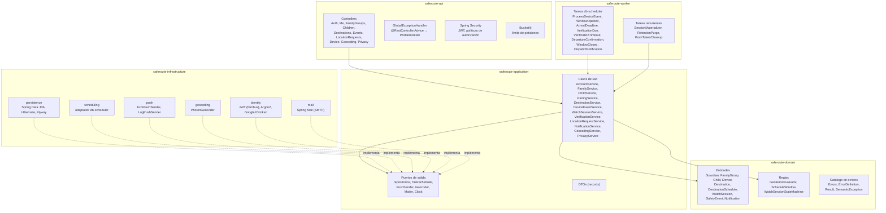

La dirección de dependencias (`domain` no depende de nada; `infrastructure` depende de `application` y `domain`) se verifica con pruebas de **ArchUnit** en el build, no solo en revisión.

### 3.2 Componentes de la app Android

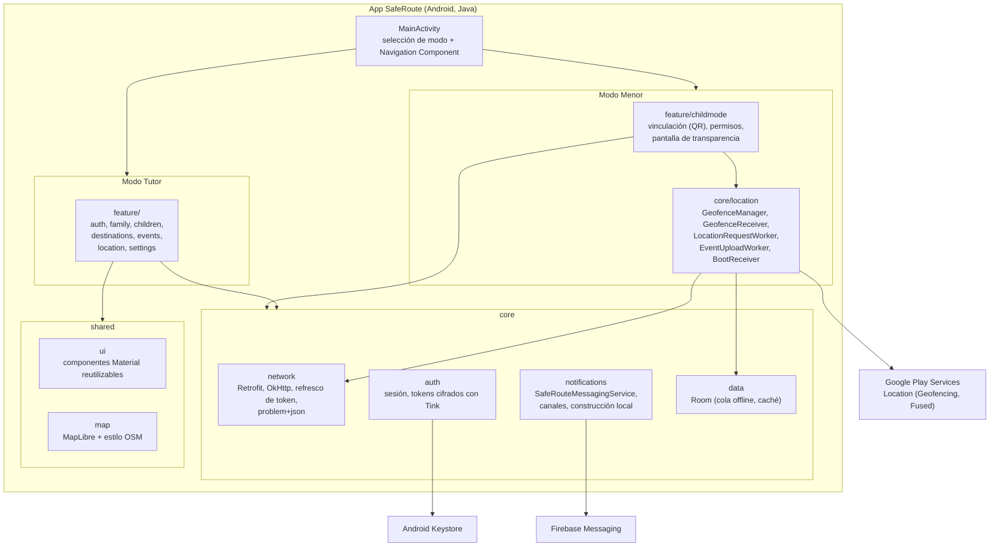

### 3.3 Despliegue

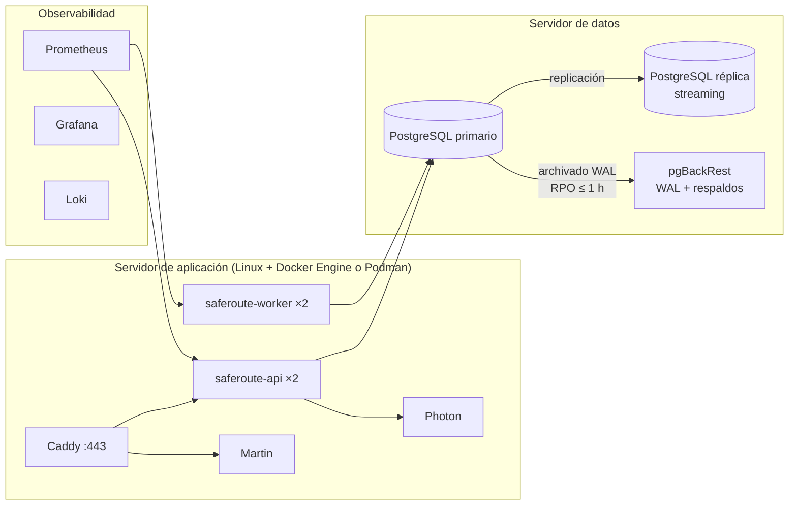

Todos los componentes de esta topología son de código abierto. La infraestructura (servidores propios o VPS) tiene costo de operación, no de licencia de software.

---

## 4. Diseño del backend

### 4.1 Plataforma

| Aspecto | Elección |
|---|---|
| Lenguaje | Java 25 LTS |
| JDK | Eclipse Temurin (OpenJDK, GPLv2 + Classpath Exception) |
| Framework | Spring Boot 4.x (Spring Framework 7, Spring Security 7) |
| Build | Maven 3.9 multimódulo |
| Persistencia | Spring Data JPA + Hibernate ORM 7 (Apache 2.0) |
| Migraciones | Flyway Community (Apache 2.0) |
| Tareas asíncronas | db-scheduler (Apache 2.0) sobre PostgreSQL |
| Empaquetado | Imagen OCI con Jib o Buildpacks, base `eclipse-temurin:25-jre` |

Las versiones exactas de cada dependencia se fijan al crear el proyecto (última estable con soporte) y se gestionan con el BOM de Spring Boot.

### 4.2 Estructura de la solución

```
backend/
├── pom.xml                         POM padre (BOM de Spring Boot, versiones, plugins)
├── saferoute-domain/               Java puro, sin Spring ni JPA
│   └── src/main/java/mx/saferoute/domain/
│       ├── model/                  Guardian, FamilyGroup, Child, Device, Destination,
│       │                           DestinationSchedule, WatchSession, SafetyEvent, ...
│       ├── common/                 Result<T>, GeoPoint, Identifier
│       ├── error/                  Errors (catálogo), ErrorDefinition, SemanticException
│       └── rule/                   GeofenceEvaluator, ScheduleWindow, WatchSessionStateMachine
├── saferoute-application/          casos de uso y puertos, sin dependencias de infraestructura
│   └── src/main/java/mx/saferoute/application/
│       ├── dto/
│       ├── port/                   repositorios, TaskScheduler, PushSender, Geocoder,
│       │                           Mailer, TokenService
│       ├── service/
│       └── validation/
├── saferoute-infrastructure/
│   └── src/main/java/mx/saferoute/infrastructure/
│       ├── persistence/            entidades JPA, repositorios, mapeos
│       ├── scheduling/             definiciones de tareas db-scheduler, adaptador TaskScheduler
│       ├── push/                   FcmPushSender, LogPushSender
│       ├── geocoding/              PhotonGeocoder (cliente HTTP con Resilience4j)
│       ├── identity/               JwtTokenService, Argon2PasswordHasher, GoogleIdTokenVerifier
│       ├── mail/
│       └── config/                 @ConfigurationProperties tipadas
│   └── src/main/resources/db/migration/   scripts Flyway V1__*.sql
├── saferoute-api/                  aplicación Spring Boot web
│   └── src/main/java/mx/saferoute/api/
│       ├── controller/
│       ├── security/
│       ├── error/                  GlobalExceptionHandler
│       └── SafeRouteApiApplication.java
├── saferoute-worker/               aplicación Spring Boot sin servidor web (solo actuator)
│   └── src/main/java/mx/saferoute/worker/
│       ├── task/                   manejadores de tareas: traducen y delegan en servicios
│       └── SafeRouteWorkerApplication.java
└── saferoute-architecture-tests/   pruebas ArchUnit de dependencias entre módulos
```

El paquete raíz `mx.saferoute` es provisional hasta confirmar el dominio (PT-06).

El esquema es nuevo, así que hay **dos niveles de modelo**: entidad de dominio y DTO. Las entidades JPA viven en `infrastructure/persistence` y se mapean a las entidades de dominio con MapStruct (Apache 2.0); `domain` no conoce JPA.

### 4.3 Responsabilidades por capa

| Capa | Contiene | No contiene | Ejemplos SafeRoute |
|---|---|---|---|
| `domain` | Entidades, invariantes, reglas puras, catálogo de errores | Spring, JPA, HTTP, java.time.Clock del sistema | `WatchSessionStateMachine.apply(state, event, now)`, `GeofenceEvaluator.isInside(point, accuracy, destination)` |
| `application` | Orquestación, transacciones, validación de entrada, DTOs, puertos | Implementaciones de infraestructura | `DeviceEventService.register(...)`, `VerificationService.runCycle(...)` |
| `infrastructure` | Adaptadores de los puertos | Reglas de negocio | `FcmPushSender`, `PhotonGeocoder`, `DbSchedulerTaskScheduler` |
| `api` | Controllers, seguridad, traducción de errores | Reglas de negocio, `try/catch` para HTTP | `DeviceController`, `DestinationController` |
| `worker` | Manejadores de tareas | Reglas de negocio | `VerificationDueTaskHandler` delega en `VerificationService` |

### 4.4 Módulos funcionales

| Módulo | Servicio principal | Requerimientos |
|---|---|---|
| Cuenta e identidad | `AccountService` | RF-001 – RF-006 |
| Grupo familiar | `FamilyService` | RF-010 – RF-013 |
| Menores y vinculación | `ChildService`, `PairingService` | RF-014 – RF-019 |
| Destinos y horarios | `DestinationService` | RF-020 – RF-028 |
| Sesiones de vigilancia | `WatchSessionService` | RF-030 – RF-035 |
| Eventos de dispositivo | `DeviceEventService` | RF-036, RF-037, RF-040 – RF-043 |
| Verificación periódica | `VerificationService` | RF-044 |
| Ubicación bajo demanda | `LocationRequestService` | RF-050, RF-051 |
| Notificaciones | `NotificationService` | RF-038, RF-039, RF-053, RF-054 |
| Búsqueda de direcciones | `GeocodingService` | RF-020 |
| Privacidad | `PrivacyService` | RF-060 – RF-063 |

### 4.5 Máquina de estados de la sesión de vigilancia

La lógica de llegada, salida y no llegada vive en `domain/rule/WatchSessionStateMachine`: una función pura que recibe el estado, el evento y la hora (de un `java.time.Clock` inyectado) y devuelve el nuevo estado y los eventos de seguridad a emitir.

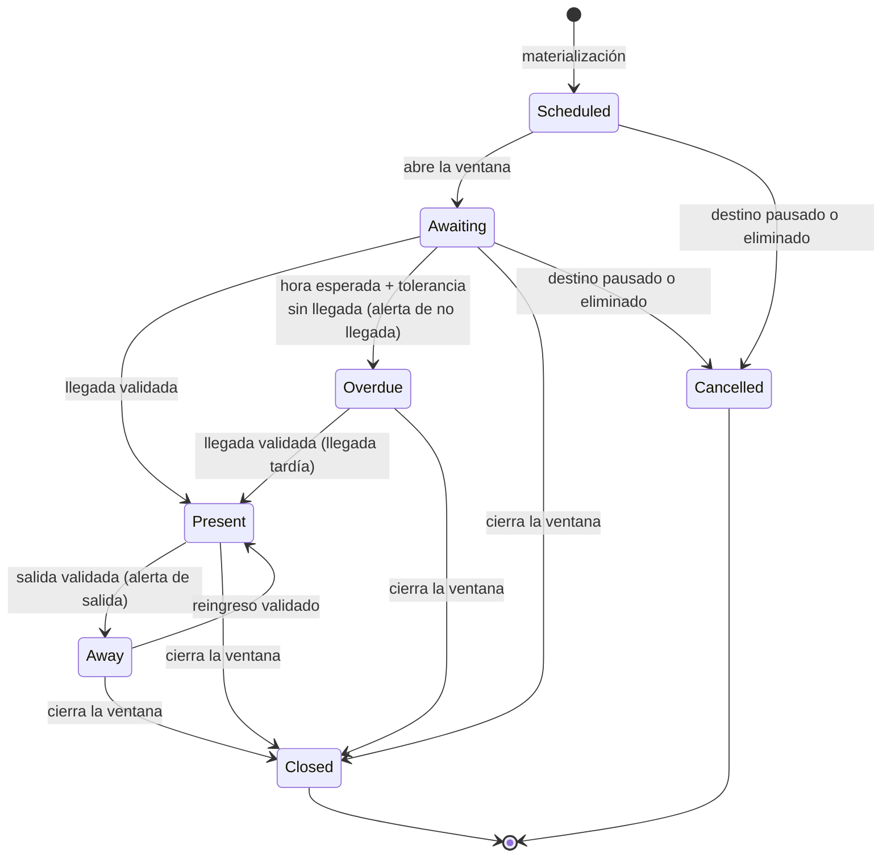

| Estado | Significado | Tareas programadas activas |
|---|---|---|
| `scheduled` | Sesión creada, ventana sin abrir. | `window-opened` |
| `awaiting` | Ventana abierta, sin llegada. | `arrival-deadline` (si hay hora esperada), `verification-due`, `window-closed` |
| `overdue` | Se emitió la alerta de no llegada. | `verification-due`, `window-closed` |
| `present` | El menor está en el destino. | `verification-due`, `window-closed` |
| `away` | El menor salió tras haber llegado. | `verification-due`, `window-closed` |
| `closed` | Ventana terminada. | — |
| `cancelled` | Destino pausado, editado o eliminado. | — |

Invariantes:

- Como máximo una llegada notificada por sesión (RF-031). `overdue → present` notifica porque es la primera llegada.
- `present → away` solo dentro de la ventana (RF-032).
- Editar un destino cancela y vuelve a materializar las sesiones futuras; la sesión en curso se conserva si el horario sigue vigente.

### 4.6 Materialización de sesiones

La tarea recurrente `session-materializer` corre cada hora y garantiza las sesiones de las próximas 36 horas:

1. Calcula las ocurrencias de cada horario activo en la zona del destino con `java.time` (`ZoneId`, `ZonedDateTime`), que usa la base IANA del JDK y resuelve los cambios de horario de verano.
2. Inserta las sesiones faltantes con `INSERT ... ON CONFLICT DO NOTHING` sobre la restricción única `(destination_schedule_id, child_id, session_date)`.
3. Por cada sesión nueva programa las tareas `window-opened`, `arrival-deadline` (si aplica) y `window-closed`, en la misma transacción.

Un cambio de destino u horario ejecuta la misma materialización en línea para la entidad afectada.

### 4.7 Procesamiento asíncrono con db-scheduler

db-scheduler persiste las tareas en la tabla `scheduled_tasks` de PostgreSQL. El API solo **programa** tareas (cliente sin ejecutor); el Worker las **ejecuta**.

| Tarea | Tipo | Identificador de instancia | Programada por | Acción |
|---|---|---|---|---|
| `process-device-event` | Única, inmediata | `{deviceEventId}` | API al recibir un evento | Valida y aplica el evento a la sesión (§8). |
| `window-opened` | Única, programada | `{watchSessionId}` | Materializador | `scheduled → awaiting`; programa el primer ciclo de verificación. |
| `arrival-deadline` | Única, programada | `{watchSessionId}` | Materializador | Plazo de llegada (§8.5). |
| `verification-due` | Única, programada | `{watchSessionId}:{cycle}` | Worker | Ciclo de verificación (§9). |
| `verification-timeout` | Única, programada | `{locationRequestId}` | Worker | Vence la espera de una ubicación solicitada. |
| `departure-confirmation` | Única, programada | `{watchSessionId}:{cycle}` | Worker | Confirma una salida sospechada a los 3 min. |
| `window-closed` | Única, programada | `{watchSessionId}` | Materializador | Cierra la sesión. |
| `dispatch-notification` | Única, inmediata | `{notificationId}` | Servicios de dominio | Envío a FCM (§10). |
| `session-materializer` | Recurrente, cada hora | — | — | §4.6 |
| `retention-purge` | Recurrente, diaria 03:00 UTC | — | — | §4.12 |
| `push-token-cleanup` | Recurrente, diaria | — | — | Invalida tokens sin renovar en 60 días. |

Reglas:

- **Transaccionalidad.** El cliente de db-scheduler usa el mismo `DataSource` transaccional de Spring: la tarea se inserta en la misma transacción que el cambio de estado. Si la transacción se revierte, la tarea no existe. Esto cumple la función de un outbox sin tabla adicional (RNF-FIA-04).
- **Idempotencia.** El identificador de instancia es determinista: programar dos veces la misma tarea no la duplica. Cada manejador además comprueba el estado y el ciclo vigente de la sesión, y descarta las tareas obsoletas.
- **Orden por menor.** Todo manejador que modifica sesiones de un menor toma primero `pg_advisory_xact_lock(hashtext(child_id))`. Así una llegada y un plazo de no llegada del mismo menor nunca se procesan en paralelo, y menores distintos sí.
- **Recogida.** Estrategia `lock-and-fetch` (`SELECT ... FOR UPDATE SKIP LOCKED`), intervalo de sondeo de 1 s, 20 hilos por instancia. Varias instancias del Worker se reparten las tareas sin coordinación adicional.
- **Fallos.** Errores transitorios (`isTransient`) se reintentan con espera exponencial (5 s, 30 s, 2 min, 10 min, 30 min). Agotados los reintentos, la tarea se registra en `failed_task` con el código del catálogo y se elimina de la cola; `failed_task` alimenta una alerta operativa.
- **Cancelación.** No se cancelan tareas programadas al cambiar el estado: el manejador las descarta por obsoletas. Es más simple y no depende de mantener referencias.

Capacidad: el volumen estimado (~12 tareas/s de media, ~120/s en picos de entrada escolar) está holgadamente dentro de lo que db-scheduler procesa sobre PostgreSQL. Si la medición en pruebas de carga lo contradice, el puerto `TaskScheduler` permite introducir RabbitMQ (MPL 2.0) sin cambiar los servicios (ADR-005).

### 4.8 Identidad y autorización

| Principal | Credencial | Alcance |
|---|---|---|
| Tutor | JWT de acceso (15 min) + token de refresco rotativo (30 días, de un solo uso) | `guardian` |
| Dispositivo del menor | JWT de acceso (15 min) + token de refresco de dispositivo rotativo (sin expiración por inactividad mientras esté vinculado) | `device`, con `deviceId` y `childId` en las claims |

- JWT firmados con ES256 mediante Nimbus JOSE + JWT; validados con el *resource server* de Spring Security. Las claves se rotan y se publican en `/.well-known/jwks.json`.
- Contraseñas con `Argon2PasswordEncoder` de Spring Security (BouncyCastle, MIT).
- Inicio de sesión con Google: la app obtiene un ID token con Credential Manager; el API lo verifica con `GoogleIdTokenVerifier` (google-api-client, Apache 2.0) contra las claves públicas de Google y el `client_id` configurado. El proyecto de Google Cloud y el cliente OAuth son gratuitos.
- Tokens de refresco guardados como hash SHA-256; reutilizar un token ya rotado revoca toda su familia (detección de robo).
- Políticas de autorización, evaluadas en el servicio de aplicación por consulta de pertenencia (RNF-SEG-04):
  - `GuardianOfFamily`: el tutor pertenece al grupo del recurso.
  - `FamilyOwner`: operaciones reservadas al tutor principal.
  - `ChildDevice`: solo `/api/v1/device/**`; el `deviceId` de la claim debe ser el dispositivo vinculado y activo.
- Desvincular un dispositivo revoca de inmediato sus tokens de refresco.

### 4.9 Modelo de errores

Se traslada a Java el modelo de errores de los estándares de Ryndem:

| Elemento | Implementación Java |
|---|---|
| `ErrorDefinition` | `record ErrorDefinition(String code, String title, String description, ErrorCategory category, Severity severity, int httpStatus, boolean isTransient)` |
| Catálogo | Clase final `Errors` con constantes agrupadas en clases anidadas (`Errors.Destination.NOT_FOUND`). Ningún código se declara en línea. |
| Flujo esperado | `sealed interface Result<T> permits Success, Failure`. El dominio falla con un solo error; solo la validación de entrada produce una lista. |
| Flujo inesperado | `SemanticException extends RuntimeException`, única base, con su `ErrorDefinition`. |
| Respuesta HTTP | `GlobalExceptionHandler` (`@RestControllerAdvice`) produce `ProblemDetail` (RFC 9457, nativo de Spring) con las propiedades `code` y `correlationId`. |
| Nivel de log | Derivado de `Severity`. |

Prefijos de dominio, además de los transversales `VAL`, `INF`, `INT` y `UNX`:

| Prefijo | Dominio | Ejemplos |
|---|---|---|
| `AUT` | Autenticación | `AUT-001` credenciales inválidas, `AUT-002` correo no verificado, `AUT-003` token de refresco reutilizado |
| `FAM` | Grupo familiar | `FAM-001` grupo no encontrado, `FAM-002` invitación expirada, `FAM-003` operación reservada al tutor principal |
| `CHD` | Menores | `CHD-001` menor no encontrado |
| `DEV` | Dispositivos y vinculación | `DEV-001` código inválido o expirado, `DEV-002` dispositivo no vinculado, `DEV-003` demasiados intentos, `DEV-004` dispositivo sin Google Play Services |
| `DST` | Destinos | `DST-001` destino no encontrado, `DST-002` límite de destinos activos, `DST-003` hora esperada fuera de la ventana |
| `SES` | Sesiones | `SES-001` sesión no encontrada, `SES-002` transición no permitida |
| `LOC` | Ubicación | `LOC-001` solicitud no encontrada, `LOC-002` precisión insuficiente |
| `GEO` | Búsqueda de direcciones | `GEO-001` geocodificador no disponible |
| `NTF` | Notificaciones | `NTF-001` token push inválido |
| `PRV` | Privacidad | `PRV-001` consentimiento vigente requerido |

La unicidad de los códigos se verifica con una prueba (`ErrorsTest`).

### 4.10 Validación y límites

- Validación de forma con Jakarta Bean Validation (Hibernate Validator, Apache 2.0) sobre los DTOs; todo fallo se devuelve como `VAL-001` con la lista `errors[]`.
- Reglas de negocio (límite de destinos, coherencia de horarios) en el dominio, con su código.
- Límite de peticiones con Bucket4j (Apache 2.0) respaldado en PostgreSQL para que valga entre instancias: `/device/pair` 5 intentos por dispositivo e IP cada 15 min; `/auth/login` 10 por cuenta e IP cada 15 min; `/geocoding/*` 30 por usuario y minuto.

### 4.11 Observabilidad

- Logs JSON a la salida estándar con Logback + logstash-logback-encoder; recolectados por Loki.
- `correlationId` por petición (filtro + MDC), guardado en los datos de cada tarea y restaurado en el MDC del Worker.
- **Nunca se registran coordenadas, tokens, correos ni nombres** (RNF-SEG-08).
- Métricas con Micrometer expuestas en `/actuator/prometheus`:

| Métrica | Uso |
|---|---|
| `saferoute.notification.latency` (evento en el dispositivo → aceptado por FCM) | RNF-PER-01 |
| `saferoute.notification.failed` por motivo | R-08 |
| `saferoute.verification.outcome` (`inside`, `outside`, `no_response`) | Salud de la verificación periódica |
| `saferoute.device.reporting_gap` | Dispositivos silenciosos |
| `saferoute.task.lag` (hora programada → inicio de ejecución) por tarea | RNF-ESC-02 |
| `saferoute.task.failed` | Alerta operativa |

- Salud: `/actuator/health/liveness` y `/actuator/health/readiness` (base de datos; Photon como indicador degradable que no bloquea el arranque).
- `/api/v1/version` con versión, commit y ambiente del artefacto.

### 4.12 Retención y borrado

`retention-purge` corre cada noche:

- Elimina `location_sample` y `device_event` con más de 30 días (RNF-PRI-03), por partición mensual cuando el volumen lo justifique (§6.4).
- Anula las coordenadas de `safety_event` con más de 30 días.
- Borra en lotes de 5 000 filas para no bloquear tablas.

El ejercicio del derecho de cancelación (RF-063, CU-09) elimina físicamente el agregado completo del grupo familiar, como excepción explícita al borrado lógico (ADR-010).

---

## 5. Diseño del frontend móvil

### 5.1 Plataforma

| Aspecto | Elección |
|---|---|
| Lenguaje | Java, nivel de lenguaje 17 con *core library desugaring* |
| SDK | `minSdk` 29 (Android 10), `targetSdk` y `compileSdk` 36 |
| Build | Gradle + Android Gradle Plugin |
| IDE | Android Studio (gratuito) |
| Interfaz | Android Views con XML, ViewBinding y Material Components (Jetpack Compose requiere Kotlin, fuera de RD-01) |
| Arquitectura de presentación | MVVM: `Fragment` + `ViewModel` + `LiveData` |
| Navegación | Navigation Component con un *nav graph* por modo |
| Inyección de dependencias | Hilt |
| Red | Retrofit + OkHttp + Moshi |
| Persistencia local | Room (cola offline de eventos, caché de menores y destinos) |
| Trabajo en segundo plano | WorkManager |
| Ubicación | Google Play Services Location: `GeofencingClient`, `FusedLocationProviderClient` |
| Push | Firebase Cloud Messaging |
| Mapas | MapLibre Native Android con teselas propias (§11) |
| Almacenamiento seguro | Tink con clave maestra en Android Keystore |
| Escaneo de QR | ZXing Android Embedded |
| Inicio de sesión con Google | AndroidX Credential Manager + Google Identity Services |

### 5.2 Estructura del proyecto

```
android/
├── settings.gradle
├── build.gradle
└── app/
    └── src/
        ├── main/java/mx/saferoute/app/
        │   ├── SafeRouteApplication.java
        │   ├── MainActivity.java
        │   ├── core/
        │   │   ├── network/        ApiClient, AuthInterceptor, TokenAuthenticator, ProblemParser
        │   │   ├── auth/           SessionManager, SecureTokenStore (Tink)
        │   │   ├── location/       GeofenceManager, GeofenceBroadcastReceiver, BootReceiver,
        │   │   │                   ExitConfirmationWorker, LocationRequestWorker,
        │   │   │                   EventUploadWorker, HeartbeatWorker
        │   │   ├── notifications/  SafeRouteMessagingService, NotificationChannels,
        │   │   │                   NotificationRenderer
        │   │   ├── permissions/    PermissionChecker, OemBatteryGuide
        │   │   ├── data/           SafeRouteDatabase (Room), DAOs
        │   │   └── di/             módulos Hilt
        │   ├── shared/
        │   │   ├── ui/             vistas y estilos Material reutilizables
        │   │   ├── map/            MapViewFactory, GeofenceOverlay
        │   │   └── util/           formato de fechas y distancias
        │   └── feature/
        │       ├── auth/           ui/, data/
        │       ├── family/
        │       ├── children/
        │       ├── destinations/
        │       ├── events/
        │       ├── location/
        │       ├── settings/
        │       └── childmode/
        ├── main/res/
        ├── test/                   pruebas unitarias JVM (JUnit, Mockito, Robolectric)
        └── androidTest/            pruebas instrumentadas (Espresso)
```

Cada feature contiene `ui/` (fragments, view models, adaptadores) y `data/` (servicio Retrofit, DTOs, repositorio y mapeo). Un feature no importa clases de otro feature; lo compartido sube a `core` o `shared`. Se verifica con ArchUnit sobre las clases compiladas en las pruebas unitarias.

### 5.3 Modo de la app

Al primer arranque se elige **Soy tutor** o **Soy menor**. El modo se guarda cifrado y determina el *nav graph*. Cambiar de modo exige cerrar sesión o desvincular el dispositivo.

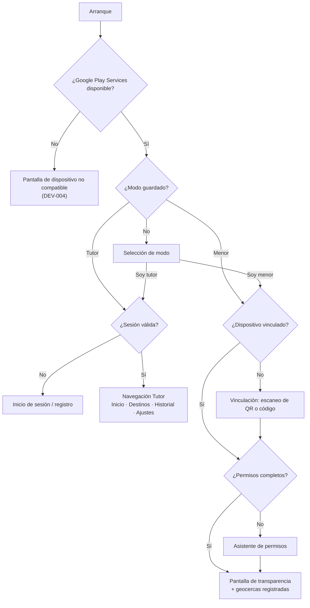

### 5.4 Pantallas del modo Tutor

| Pantalla | Contenido | Requerimientos |
|---|---|---|
| Inicio | Tarjeta por menor: estado (en destino, en camino, fuera, sin conexión), próximo destino, estado del dispositivo | RF-043 |
| Detalle de menor | Destinos, eventos recientes, botón "Ver ubicación actual" | RF-050 |
| Lista de destinos | Estado: activo, pausado, pendiente de sincronizar | RF-025, RF-027 |
| Editor de destino | Mapa MapLibre, búsqueda de dirección (Photon vía API), control del radio con vista previa del círculo, menores, horario, tolerancia | RF-020 – RF-024 |
| Historial | Lista con filtros; detalle con mapa mientras la ubicación siga disponible | RF-052 |
| Grupo familiar | Tutores, invitaciones, menores, generación del QR de vinculación | RF-010 – RF-019 |
| Ajustes | Preferencias de notificación, alertas prioritarias, privacidad, exportación, licencias de código abierto, eliminar cuenta | RF-053, RF-054, RF-060 – RF-063, RNF-LIC-04 |

### 5.5 Modo Menor: geocercas y ubicación

**Geocercas por destino.** `GeofenceManager` registra dos geocercas por destino asignado con `GeofencingClient`:

| `requestId` | Radio | Transición | Parámetros | Uso |
|---|---|---|---|---|
| `dst:{destinationId}:in` | Radio del destino | `GEOFENCE_TRANSITION_DWELL` | `setLoiteringDelay(60_000)` | Llegada (RF-030) |
| `dst:{destinationId}:out` | Radio + 50 m | `GEOFENCE_TRANSITION_EXIT` | `setNotificationResponsiveness(30_000)` | Inicio de una posible salida (RF-032) |

Con 10 destinos por menor son 20 geocercas, dentro del límite de 100 por app. `setInitialTrigger(INITIAL_TRIGGER_DWELL)` detecta si el menor ya está dentro al registrar.

**Recepción.** Las transiciones llegan a `GeofenceBroadcastReceiver` mediante un `PendingIntent` mutable. El receptor no hace trabajo largo: escribe el evento en la cola Room y encola un `EventUploadWorker` *expedited*. Para el `EXIT` encola además `ExitConfirmationWorker` con retraso de 3 minutos: si una nueva lectura sigue fuera del radio con histéresis, emite `GEOFENCE_EXIT`; si el menor volvió, lo descarta. WorkManager puede diferir el retraso en Doze; la verificación del servidor (§9) cubre ese caso.

**Reregistro obligatorio.** Android elimina las geocercas en varios casos, y la app debe volver a registrarlas:

| Disparador | Mecanismo |
|---|---|
| Reinicio del dispositivo | `BootReceiver` (`BOOT_COMPLETED`) |
| Actualización de la app | `BootReceiver` (`MY_PACKAGE_REPLACED`) |
| Ubicación desactivada y reactivada | `GEOFENCE_NOT_AVAILABLE` en el receptor + comprobación en `HeartbeatWorker` |
| Datos de Google Play Services borrados | Comprobación en `HeartbeatWorker` |
| Cambio de configuración en el servidor | Push de datos `CONFIG_CHANGED` |

**Cola offline.** Todo evento se guarda primero en Room con un `eventId` UUID v7 generado en el dispositivo y la hora real del hecho. `EventUploadWorker` envía lotes con restricción de red, con reintento exponencial de WorkManager. El backend deduplica por `eventId` (RF-036, RF-037).

**Sincronización de geocercas.** `GET /api/v1/device/geofences` al arrancar, al recibir `CONFIG_CHANGED` y cada 6 horas (`PeriodicWorkRequest`). La respuesta trae `configVersion`; el dispositivo confirma la versión aplicada en el latido, y el backend sabe qué destinos siguen "pendientes de sincronizar".

**Permisos.** En Android 10 se solicita `ACCESS_BACKGROUND_LOCATION` tras `ACCESS_FINE_LOCATION`; en Android 11+ el usuario debe elegir "Permitir todo el tiempo" en la configuración del sistema, y el asistente lo lleva a esa pantalla con una explicación previa. También se verifican `POST_NOTIFICATIONS` (Android 13+), ubicación precisa y la exclusión de optimización de batería, con una guía específica por fabricante (`OemBatteryGuide`). Cualquier cambio se reporta con `PERMISSION_CHANGED` (RF-040).

**Solicitudes de ubicación.** Un mensaje FCM de datos de prioridad alta `LOCATION_REQUEST` llega a `SafeRouteMessagingService.onMessageReceived`, que encola `LocationRequestWorker` *expedited*. El worker llama a `getCurrentLocation(Priority.PRIORITY_HIGH_ACCURACY, token)` con 25 s de tiempo máximo y envía el resultado a `POST /api/v1/device/locations`. Con el permiso de ubicación en segundo plano concedido, la lectura se permite sin servicio en primer plano; 3 lecturas por hora están dentro de los límites de ubicación en segundo plano de Android.

**Ubicación simulada.** `Location.isMock()` se envía en cada lectura (RT-04).

**Latido.** `HeartbeatWorker` envía batería, permisos y `configVersion` cada 15 minutos (mínimo de WorkManager) mientras haya una ventana activa conocida por el dispositivo, y en cada respuesta a una verificación.

### 5.6 Manejo de errores en la app

- `ProblemParser` interpreta `application/problem+json`: `code` decide el mensaje (recursos de cadenas por código) y `errors[]` se asigna a los campos del formulario con `VAL-001`.
- La opción "Reportar un problema" incluye `code` y `correlationId`.
- Sin red, se muestra un estado sin conexión y se conserva lo capturado.

### 5.7 Accesibilidad

WCAG 2.1 AA (RNF-USA-02): `contentDescription` en todo control, objetivos de toque ≥ 48 dp, tamaños en `sp`, contraste ≥ 4,5:1 y una alternativa numérica al control del radio para TalkBack. Se revisa con Accessibility Scanner y las comprobaciones de accesibilidad de Espresso.

---

## 6. Modelo de datos

### 6.1 Convenciones

PostgreSQL 18, base de datos nueva y en inglés. Se conservan los principios del estándar de base de datos de Ryndem y se adapta la forma de los nombres a PostgreSQL (ADR-009):

| Regla | Aplicación |
|---|---|
| Nombres | `snake_case`, singular: `watch_session`, `safety_event`. PostgreSQL convierte a minúsculas los identificadores sin comillas, y `camelCase` obligaría a entrecomillar cada nombre. |
| Clave primaria | `<tabla>_id uuid NOT NULL DEFAULT uuidv7()` |
| Campos de control | `created_at` y `updated_at` (`timestamptz NOT NULL DEFAULT now()`), `is_active` (`boolean NOT NULL DEFAULT true`) en toda tabla |
| Catálogos | Prefijo `cat_` y clave de negocio estable `code` |
| Cadenas | `varchar(50)`, `varchar(500)` o `text` |
| Coordenadas | `numeric(9,6)` (resolución ~0,1 m) |
| Restricciones | Con nombre explícito: `pk_`, `fk_`, `uq_`, `ck_`, `ix_` |
| Concurrencia | Columna `version bigint` con `@Version` de JPA en tablas con transiciones de estado |
| Migraciones | Flyway, scripts versionados `V<n>__<descripcion>.sql`, revisados en el PR |

### 6.2 Diagrama entidad-relación

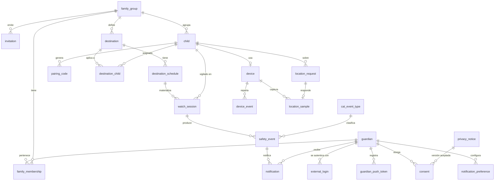

### 6.3 Diccionario de datos

Los campos de control (`created_at`, `updated_at`, `is_active`) están en todas las tablas y se omiten abajo.

#### Identidad y grupo familiar

**`guardian`**

| Columna | Tipo | Nulo | Descripción |
|---|---|---|---|
| `guardian_id` | `uuid` | No | PK |
| `email` | `varchar(500)` | No | Único (`uq_guardian_email`), en minúsculas |
| `password_hash` | `varchar(500)` | Sí | Argon2id; nulo si solo usa Google |
| `display_name` | `varchar(50)` | No | |
| `phone_number` | `varchar(50)` | Sí | E.164 |
| `photo_url` | `varchar(500)` | Sí | |
| `is_email_verified` | `boolean` | No | |
| `deletion_requested_at` | `timestamptz` | Sí | Previo al borrado físico |

**`external_login`** — `external_login_id`, `guardian_id` (FK), `provider` (`varchar(50)`, `ck_external_login_provider`: `google`), `subject` (`varchar(500)`). Único `(provider, subject)`.

**`refresh_token`** — `refresh_token_id`, `principal_type` (`guardian` | `device`), `principal_id`, `token_hash` (único), `family_id`, `expires_at` (nulo para dispositivo), `revoked_at`, `replaced_by_token_id`.

**`family_group`** — `family_group_id`, `name` (`varchar(50)`), `owner_guardian_id` (FK).

**`family_membership`** — `family_membership_id`, `family_group_id` (FK), `guardian_id` (FK), `role` (`ck_family_membership_role`: `owner`, `member`). Único `(family_group_id, guardian_id)`.

**`invitation`** — `invitation_id`, `family_group_id` (FK), `invited_by_guardian_id` (FK), `email` (nulo si es por enlace), `token_hash` (único), `expires_at`, `accepted_at`, `accepted_by_guardian_id`.

#### Menores y dispositivos

**`child`** — `child_id`, `family_group_id` (FK), `display_name` (`varchar(50)`), `birth_year` (`smallint`, `ck_child_birth_year`), `photo_url`.

**`device`**

| Columna | Tipo | Nulo | Descripción |
|---|---|---|---|
| `device_id` | `uuid` | No | PK |
| `child_id` | `uuid` | No | FK; índice único parcial `WHERE is_active` (RF-016) |
| `manufacturer`, `model` | `varchar(50)` | No | Para diagnóstico por fabricante |
| `os_version`, `app_version` | `varchar(50)` | No | |
| `push_token` | `varchar(500)` | Sí | Token FCM |
| `location_permission` | `varchar(50)` | No | `always`, `while_in_use`, `denied` |
| `is_precise_location` | `boolean` | No | |
| `is_battery_optimization_exempt` | `boolean` | No | |
| `pairing_status` | `varchar(50)` | No | `complete`, `incomplete` |
| `battery_level` | `smallint` | Sí | 0–100 |
| `applied_config_version` | `integer` | No | |
| `last_seen_at` | `timestamptz` | Sí | |
| `paired_at` | `timestamptz` | No | |
| `unpaired_at` | `timestamptz` | Sí | |

**`pairing_code`** — `pairing_code_id`, `child_id` (FK), `code_hash` (único), `expires_at` (+15 min), `redeemed_at`, `created_by_guardian_id`.

#### Destinos y sesiones

**`destination`**

| Columna | Tipo | Nulo | Descripción |
|---|---|---|---|
| `destination_id` | `uuid` | No | PK |
| `family_group_id` | `uuid` | No | FK |
| `name` | `varchar(50)` | No | |
| `icon` | `varchar(50)` | No | |
| `address` | `varchar(500)` | Sí | |
| `latitude` | `numeric(9,6)` | No | `ck_destination_latitude` (−90 a 90) |
| `longitude` | `numeric(9,6)` | No | `ck_destination_longitude` (−180 a 180) |
| `radius_meters` | `integer` | No | `ck_destination_radius_meters` (100 a 1 000) |
| `time_zone_id` | `varchar(50)` | No | IANA, p. ej. `America/Mexico_City` |
| `status` | `varchar(50)` | No | `active`, `paused` |
| `config_version` | `integer` | No | Se incrementa en cada cambio |

**`destination_child`** — `destination_child_id`, `destination_id` (FK), `child_id` (FK). Único `(destination_id, child_id)`. El límite de 10 destinos activos por menor se valida en el dominio.

**`destination_schedule`**

| Columna | Tipo | Nulo | Descripción |
|---|---|---|---|
| `destination_schedule_id` | `uuid` | No | PK |
| `destination_id` | `uuid` | No | FK |
| `recurrence_type` | `varchar(50)` | No | `once`, `weekly` |
| `specific_date` | `date` | Sí | Requerido si `once` (`ck_destination_schedule_recurrence`) |
| `days_of_week` | `smallint[]` | Sí | ISO 1 = lunes … 7 = domingo; requerido si `weekly` |
| `window_start_time` | `time` | No | Hora local del destino |
| `window_end_time` | `time` | No | `ck_destination_schedule_window_order` |
| `expected_arrival_time` | `time` | Sí | `ck_destination_schedule_expected_arrival_in_window` |
| `tolerance_minutes` | `smallint` | No | 5–60, por defecto 15 |

**`watch_session`**

| Columna | Tipo | Nulo | Descripción |
|---|---|---|---|
| `watch_session_id` | `uuid` | No | PK |
| `destination_schedule_id` | `uuid` | No | FK |
| `destination_id` | `uuid` | No | FK (desnormalizado) |
| `child_id` | `uuid` | No | FK |
| `session_date` | `date` | No | Fecha civil en la zona del destino |
| `window_starts_at`, `window_ends_at` | `timestamptz` | No | |
| `arrival_deadline_at` | `timestamptz` | Sí | Hora esperada + tolerancia |
| `status` | `varchar(50)` | No | `scheduled`, `awaiting`, `overdue`, `present`, `away`, `closed`, `cancelled` (`ck_watch_session_status`) |
| `arrived_at` | `timestamptz` | Sí | Primera llegada |
| `last_departed_at` | `timestamptz` | Sí | |
| `verification_cycle` | `integer` | No | Ciclo vigente |
| `last_verified_at` | `timestamptz` | Sí | |
| `pending_departure_since` | `timestamptz` | Sí | Salida sospechada pendiente de confirmar |
| `consecutive_failed_checks` | `smallint` | No | |
| `is_offline_alerted` | `boolean` | No | Alerta de sin conexión ya emitida en la sesión |
| `version` | `bigint` | No | Bloqueo optimista |

Restricción `uq_watch_session_schedule_child_date` sobre `(destination_schedule_id, child_id, session_date)`. Índice `ix_watch_session_child_id_status`.

#### Eventos y ubicación

**`device_event`** (retención 30 días)

| Columna | Tipo | Nulo | Descripción |
|---|---|---|---|
| `device_event_id` | `uuid` | No | PK, **generado en el dispositivo** (UUID v7) |
| `device_id` | `uuid` | No | FK |
| `type` | `varchar(50)` | No | `GEOFENCE_DWELL`, `GEOFENCE_EXIT`, `PERMISSION_CHANGED`, `BATTERY_LOW`, `GEOFENCE_NOT_AVAILABLE` |
| `destination_id` | `uuid` | Sí | |
| `occurred_at` | `timestamptz` | No | Hora del hecho en el dispositivo |
| `received_at` | `timestamptz` | No | |
| `latitude`, `longitude` | `numeric(9,6)` | Sí | |
| `accuracy_meters` | `numeric(7,1)` | Sí | |
| `is_mock` | `boolean` | No | |
| `payload` | `jsonb` | Sí | Datos específicos del tipo |
| `processing_status` | `varchar(50)` | No | `pending`, `processed`, `ignored` |

**`location_sample`** (retención 30 días) — `location_sample_id`, `device_id` (FK), `location_request_id` (FK, nulo), `source` (`on_demand`, `verification`, `event`, `heartbeat`), `captured_at`, `latitude`, `longitude`, `accuracy_meters`, `is_mock`. Índice `ix_location_sample_device_id_captured_at`.

**`location_request`** — `location_request_id`, `child_id` (FK), `requested_by_guardian_id` (FK, nulo si lo pide el sistema), `reason` (`on_demand`, `verification`, `arrival_deadline`, `arrival_confirmation`), `watch_session_id` (FK, nulo), `status` (`pending`, `fulfilled`, `timed_out`), `responded_at`.

**`cat_event_type`** — `event_type_id`, `code` (`ARRIVAL`, `LATE_ARRIVAL`, `DEPARTURE`, `RETURN`, `NO_ARRIVAL`, `PERMISSION_REVOKED`, `DEVICE_OFFLINE`, `DEVICE_RECONNECTED`, `BATTERY_LOW`, `LOCATION_QUERY`), `is_priority_by_default`, `description`. Se llena con un script Flyway que identifica cada fila por `code`.

**`safety_event`**

| Columna | Tipo | Nulo | Descripción |
|---|---|---|---|
| `safety_event_id` | `uuid` | No | PK |
| `child_id` | `uuid` | No | FK |
| `event_type_id` | `uuid` | No | FK → `cat_event_type` |
| `watch_session_id` | `uuid` | Sí | FK |
| `destination_id` | `uuid` | Sí | FK |
| `occurred_at` | `timestamptz` | No | Hora real del hecho |
| `latitude`, `longitude` | `numeric(9,6)` | Sí | Se anulan a los 30 días |
| `accuracy_meters` | `numeric(7,1)` | Sí | |
| `is_location_unverified` | `boolean` | No | Ubicación simulada detectada |
| `actor_guardian_id` | `uuid` | Sí | Tutor que consultó la ubicación |
| `dedup_key` | `varchar(500)` | No | Único; p. ej. `ARRIVAL:{watch_session_id}` |

Índice `ix_safety_event_child_id_occurred_at` (`occurred_at DESC`) para el historial.

#### Notificaciones

**`guardian_push_token`** — `guardian_push_token_id`, `guardian_id` (FK), `token` (único), `last_registered_at`, `invalidated_at`.

**`notification_preference`** — `notification_preference_id`, `guardian_id` (FK), `destination_id` (FK, nulo = global), `event_type_id` (FK), `is_enabled`, `is_priority`. Único `(guardian_id, destination_id, event_type_id)` con `NULLS NOT DISTINCT`.

**`notification`** — `notification_id`, `safety_event_id` (FK), `guardian_id` (FK), `priority` (`normal`, `high`), `status` (`pending`, `sent`, `failed`, `skipped`), `attempts`, `provider_message_id`, `last_error_code`, `sent_at`, `read_at`. Único `(safety_event_id, guardian_id)`.

#### Privacidad y operación

**`privacy_notice`** — `privacy_notice_id`, `version` (único), `published_at`, `url`.

**`consent`** — `consent_id`, `guardian_id` (FK), `privacy_notice_id` (FK), `scope` (`terms`, `child_location`), `granted_at`, `revoked_at`.

**`data_export`** — `data_export_id`, `family_group_id` (FK), `requested_by_guardian_id` (FK), `status`, `file_path`, `expires_at`.

**`scheduled_tasks`** — tabla propia de db-scheduler (esquema definido por la librería, creado con Flyway).

**`failed_task`** — `failed_task_id`, `task_name`, `task_instance`, `error_code`, `error_detail`, `failed_at`, `correlation_id`.

### 6.4 Estimación de volumen

Para 50 000 familias (RNF-ESC-01), 1,5 menores por familia y 2 sesiones diarias por menor:

| Tabla | Filas por día | Filas retenidas | Nota |
|---|---|---|---|
| `watch_session` | 150 000 | ~55 M/año | Sin coordenadas; archivable |
| `device_event` | ~1 M | ~30 M | Retención 30 días |
| `location_sample` | ~2,3 M | ~70 M | Incluye verificación cada 20 min |
| `safety_event` | ~450 000 | Indefinido | Coordenadas anuladas a 30 días |
| `notification` | ~700 000 | 90 días | |
| `scheduled_tasks` | ~3 M ejecuciones | Decenas de miles vivas | Las tareas ejecutadas se eliminan |

`location_sample` y `device_event` se definen como **tablas particionadas por mes** (particionado declarativo nativo de PostgreSQL) desde la primera migración; la purga se hace con `DROP` de la partición vencida.

---

## 7. APIs y endpoints

### 7.1 Convenciones

| Aspecto | Convención |
|---|---|
| Base | `https://<dominio>/api/v1` (local: `http://10.0.2.2:8080/api/v1` desde el emulador) |
| Formato | JSON, propiedades `camelCase`, fechas ISO 8601 en UTC con `Z` |
| Versionado | Por ruta (`/v1`); un cambio incompatible crea `/v2` |
| Autenticación | `Authorization: Bearer <jwt>` |
| Errores | `application/problem+json` con `code` y `correlationId` |
| Paginación | Por cursor: `?limit=50&cursor=<opaco>` → `{ "items": [...], "nextCursor": "..." }` |
| Idempotencia | `Idempotency-Key` en los `POST` de creación; los eventos del dispositivo usan su `eventId` |
| Correlación | `X-Correlation-Id` aceptado y devuelto |
| Versión mínima de app | `X-App-Version`; si es inferior a la mínima, `426` con `VAL-002` |
| Documentación | OpenAPI con springdoc-openapi; Swagger UI solo en `development` y `qa` |

### 7.2 Autenticación

| Método | Ruta | Descripción | Auth | RF |
|---|---|---|---|---|
| `POST` | `/auth/register` | Registro con correo y contraseña | Pública | RF-001, RF-005 |
| `POST` | `/auth/login` | Inicio de sesión | Pública | RF-001 |
| `POST` | `/auth/google` | Inicio de sesión o registro con ID token de Google | Pública | RF-002 |
| `POST` | `/auth/refresh` | Rotación de tokens | Token de refresco | RNF-SEG-03 |
| `POST` | `/auth/logout` | Revoca el token de refresco | Tutor o dispositivo | |
| `POST` | `/auth/email/verify` | Verifica el correo | Pública | RF-003 |
| `POST` | `/auth/email/resend` | Reenvía la verificación | Tutor | RF-003 |
| `POST` | `/auth/password/forgot` | Envía el enlace de recuperación (respuesta idéntica exista o no el correo) | Pública | RF-004 |
| `POST` | `/auth/password/reset` | Restablece la contraseña | Pública | RF-004 |
| `GET` | `/.well-known/jwks.json` | Claves públicas de firma | Pública | |

### 7.3 Perfil del tutor y preferencias

| Método | Ruta | Descripción | RF |
|---|---|---|---|
| `GET` | `/me` | Perfil, grupos y estado de consentimiento | |
| `PATCH` | `/me` | Actualiza el perfil | F-01 |
| `DELETE` | `/me` | Elimina la cuenta (reautenticación reciente) | RF-006, RF-063 |
| `PUT` | `/me/push-tokens/{token}` | Registra o renueva el token FCM | |
| `DELETE` | `/me/push-tokens/{token}` | Elimina el token | |
| `GET` | `/me/notification-preferences` | Preferencias | RF-053 |
| `PUT` | `/me/notification-preferences` | Reemplaza preferencias | RF-053, RF-054 |
| `GET` | `/me/notifications` | Bandeja (paginada) | |
| `POST` | `/me/notifications/{notificationId}/read` | Marca como leída | |

### 7.4 Grupo familiar

| Método | Ruta | Descripción | Política | RF |
|---|---|---|---|---|
| `GET` | `/family-groups` | Grupos del tutor | Tutor | RF-013 |
| `GET` | `/family-groups/{familyGroupId}` | Tutores y menores | `GuardianOfFamily` | |
| `PATCH` | `/family-groups/{familyGroupId}` | Renombra | `FamilyOwner` | |
| `POST` | `/family-groups/{familyGroupId}/invitations` | Crea invitación | `FamilyOwner` | RF-011 |
| `POST` | `/invitations/{token}/accept` | Acepta invitación | Tutor | RF-011 |
| `DELETE` | `/family-groups/{familyGroupId}/members/{guardianId}` | Revoca a un tutor | `FamilyOwner` | RF-012 |
| `POST` | `/family-groups/{familyGroupId}/ownership-transfer` | Transfiere el rol de principal | `FamilyOwner` | CU-09 |

### 7.5 Menores y vinculación

| Método | Ruta | Descripción | Política | RF |
|---|---|---|---|---|
| `GET` | `/family-groups/{familyGroupId}/children` | Menores con estado | `GuardianOfFamily` | RF-043 |
| `POST` | `/family-groups/{familyGroupId}/children` | Crea un menor | `GuardianOfFamily` | RF-014 |
| `GET` | `/children/{childId}` | Detalle, estado del dispositivo y sesión actual | `GuardianOfFamily` | RF-043 |
| `PATCH` | `/children/{childId}` | Actualiza perfil | `GuardianOfFamily` | RF-014 |
| `DELETE` | `/children/{childId}` | Elimina menor y datos | `FamilyOwner` | RF-063 |
| `POST` | `/children/{childId}/pairing-codes` | Genera código de vinculación (texto + contenido del QR) | `GuardianOfFamily` | RF-015 |
| `DELETE` | `/children/{childId}/device` | Desvincula | `GuardianOfFamily` | RF-019 |

### 7.6 Destinos y búsqueda de direcciones

| Método | Ruta | Descripción | RF |
|---|---|---|---|
| `GET` | `/family-groups/{familyGroupId}/destinations` | Lista con estado de sincronización | RF-027 |
| `POST` | `/family-groups/{familyGroupId}/destinations` | Crea destino con horarios y menores | RF-020 – RF-024, RF-026 |
| `GET` | `/destinations/{destinationId}` | Detalle | |
| `PUT` | `/destinations/{destinationId}` | Reemplaza destino y horarios | RF-025 |
| `PATCH` | `/destinations/{destinationId}/status` | Pausa o reanuda | RF-025 |
| `DELETE` | `/destinations/{destinationId}` | Elimina (borrado lógico) | RF-025 |
| `GET` | `/geocoding/search?q=&lat=&lon=` | Autocompletado de direcciones (proxy a Photon, sesgado por cercanía) | RF-020 |
| `GET` | `/geocoding/reverse?lat=&lon=` | Dirección de un punto del mapa | RF-020 |

**Ejemplo — crear destino**

```http
POST /api/v1/family-groups/0192b6b0-.../destinations
Content-Type: application/json
Idempotency-Key: 0192b6c4-7d1e-7a8b-9c2d-1e3f4a5b6c7d
```

```json
{
  "name": "Escuela",
  "icon": "school",
  "address": "Av. Insurgentes Sur 1234, Ciudad de México",
  "latitude": 19.371234,
  "longitude": -99.178456,
  "radiusMeters": 150,
  "timeZoneId": "America/Mexico_City",
  "childIds": ["0192b6b2-..."],
  "schedules": [
    {
      "recurrenceType": "weekly",
      "daysOfWeek": ["MONDAY", "TUESDAY", "WEDNESDAY", "THURSDAY", "FRIDAY"],
      "windowStartTime": "07:00",
      "windowEndTime": "14:00",
      "expectedArrivalTime": "07:30",
      "toleranceMinutes": 15
    }
  ]
}
```

Respuesta `201 Created` con el destino, `configVersion` y `syncStatus` por menor (`pending` hasta que el dispositivo confirme).

### 7.7 Historial y ubicación

| Método | Ruta | Descripción | RF |
|---|---|---|---|
| `GET` | `/children/{childId}/events` | Historial; filtros `type`, `destinationId`, `from`, `to` | RF-052 |
| `GET` | `/children/{childId}/watch-sessions?date=` | Sesiones del día | |
| `POST` | `/children/{childId}/location-requests` | Solicita ubicación; `202` con `locationRequestId` | RF-050, RF-051 |
| `GET` | `/location-requests/{locationRequestId}` | Estado y resultado; la app consulta cada 2 s hasta 30 s | RF-050 |

```json
{
  "locationRequestId": "0192b6d0-...",
  "status": "fulfilled",
  "location": {
    "latitude": 19.371190,
    "longitude": -99.178501,
    "accuracyMeters": 12.0,
    "capturedAt": "2026-10-21T13:42:07Z",
    "isFresh": true
  }
}
```

Con `status: timed_out`, `location` es la última conocida con `isFresh: false`.

### 7.8 Endpoints del dispositivo del menor

Política `ChildDevice`, salvo `pair`.

| Método | Ruta | Descripción | RF |
|---|---|---|---|
| `POST` | `/device/pair` | Canjea el código; devuelve tokens de dispositivo | RF-015, RF-016 |
| `GET` | `/device/geofences` | Geocercas y ventanas vigentes con `configVersion` | RF-027 |
| `POST` | `/device/events` | Lote de eventos (máx. 100) | RF-030, RF-032, RF-036, RF-040, RF-042 |
| `POST` | `/device/locations` | Ubicación en respuesta a una solicitud | RF-044, RF-050 |
| `POST` | `/device/heartbeat` | Batería, permisos y versión de configuración | RF-041, RF-043 |
| `PUT` | `/device/push-token` | Registra o renueva el token FCM | |

**Ejemplo — lote de eventos**

```json
{
  "events": [
    {
      "eventId": "0192b6c8-1a2b-7c3d-8e4f-5a6b7c8d9e0f",
      "type": "GEOFENCE_DWELL",
      "destinationId": "0192b6b5-...",
      "occurredAt": "2026-10-21T13:21:44Z",
      "location": {
        "latitude": 19.371301,
        "longitude": -99.178390,
        "accuracyMeters": 18.5,
        "isMock": false
      },
      "batteryLevel": 64
    }
  ]
}
```

Respuesta `202 Accepted`:

```json
{ "accepted": ["0192b6c8-..."], "duplicates": [], "rejected": [] }
```

Los duplicados se devuelven en `duplicates` para que el dispositivo los retire de su cola. `rejected` trae los eventos inválidos con su `code`; el dispositivo los descarta sin reintentar.

### 7.9 Privacidad

| Método | Ruta | Descripción | RF |
|---|---|---|---|
| `GET` | `/privacy/notice` | Aviso vigente | RF-060 |
| `POST` | `/me/consents` | Registra consentimiento | RF-060, RF-061 |
| `POST` | `/family-groups/{familyGroupId}/exports` | Solicita exportación JSON | RF-062 |
| `GET` | `/exports/{dataExportId}` | Estado y descarga temporal | RF-062 |

### 7.10 Operación

| Método | Ruta | Descripción |
|---|---|---|
| `GET` | `/actuator/health/liveness` | Proceso vivo |
| `GET` | `/actuator/health/readiness` | Dependencias disponibles |
| `GET` | `/actuator/prometheus` | Métricas (red interna únicamente) |
| `GET` | `/api/v1/version` | Versión, commit y ambiente |

---

## 8. Flujo de validación de llegada

### 8.1 Visión general

La llegada se detecta en el dispositivo y se **valida** en el backend.

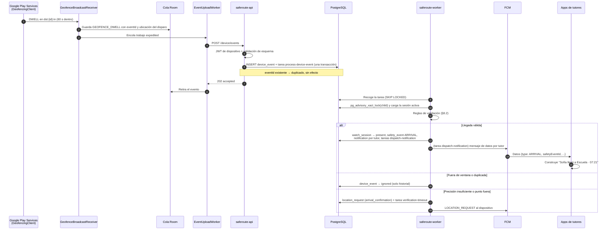

### 8.2 Reglas de validación

`WatchSessionService.handleGeofenceDwell` aplica las reglas en orden y se detiene en la primera que no se cumple:

| # | Regla | Si no se cumple |
|---|---|---|
| 1 | El dispositivo está vinculado y activo, y el destino está asignado al menor. | `ignored` (log `WARN` con `DEV-002` o `DST-001`). |
| 2 | Corrección de reloj: si `occurredAt` > `receivedAt` + 2 min, se usa `receivedAt`. | Se corrige y continúa. |
| 3 | Hay una sesión del menor para ese destino cuya ventana contiene `occurredAt`, en `awaiting` u `overdue`. | `present`: sin efecto. `away`: reingreso (§8.4). Sin sesión: solo historial. |
| 4 | La ubicación no es simulada (`isMock = false`). | Se registra con `is_location_unverified` y la notificación lo indica. |
| 5 | Precisión suficiente: `accuracyMeters` ≤ 150 m. | Confirmación con ubicación fresca (§8.3). |
| 6 | El punto está dentro: `distancia(centro, punto) ≤ radio + min(precisión, 50 m)`. | Confirmación con ubicación fresca (§8.3). |
| 7 | No existe ya un `ARRIVAL` para la sesión (`dedup_key = ARRIVAL:{watchSessionId}`). | Sin efecto (RF-031). |

La distancia se calcula con Haversine en `GeofenceEvaluator`, función pura con pruebas unitarias.

Si todas se cumplen, en una sola transacción:

1. `watch_session.status = present`, `arrived_at = occurredAt`.
2. `safety_event` `ARRIVAL`, o `LATE_ARRIVAL` si la sesión estaba en `overdue`.
3. Una fila de `notification` por tutor según sus preferencias.
4. Una tarea `dispatch-notification` por notificación.

### 8.3 Confirmación con ubicación fresca

Cuando la señal es dudosa (reglas 5 y 6):

1. Se crea una `location_request` con `reason = arrival_confirmation`.
2. Se envía `LOCATION_REQUEST` al dispositivo.
3. Se programa `verification-timeout` a 2 minutos.
4. Al llegar la ubicación (`POST /device/locations`) se reevalúan las reglas 5 y 6; si se cumplen, se registra la llegada con el `occurredAt` del evento original.
5. Si vence el plazo sin una lectura válida, el evento queda `ignored` y el siguiente ciclo de verificación volverá a comprobar (§9).

### 8.4 Llegadas por vías alternas

| Vía | Cuándo | Tratamiento |
|---|---|---|
| Disparo inicial | El menor ya está dentro al registrar la geocerca. | `INITIAL_TRIGGER_DWELL` produce un `DWELL`; mismo flujo. |
| Ciclo de verificación | La geocerca no se disparó. | La verificación detecta al menor dentro y registra la llegada (§9.3). |
| Plazo de llegada | En `arrival-deadline`, antes de alertar. | Ubicación fresca; si está dentro, se registra la llegada en lugar de la alerta (RF-035). |
| Evento diferido | El dispositivo estuvo sin conexión. | Se procesa con el `occurredAt` original. Ventana cerrada: solo historial. Tras una alerta de no llegada: `LATE_ARRIVAL` con la hora real. |
| Reingreso | `DWELL` con la sesión en `away`. | `away → present`, `RETURN` (RF-033). |

### 8.5 Plazo de llegada (no llegada)

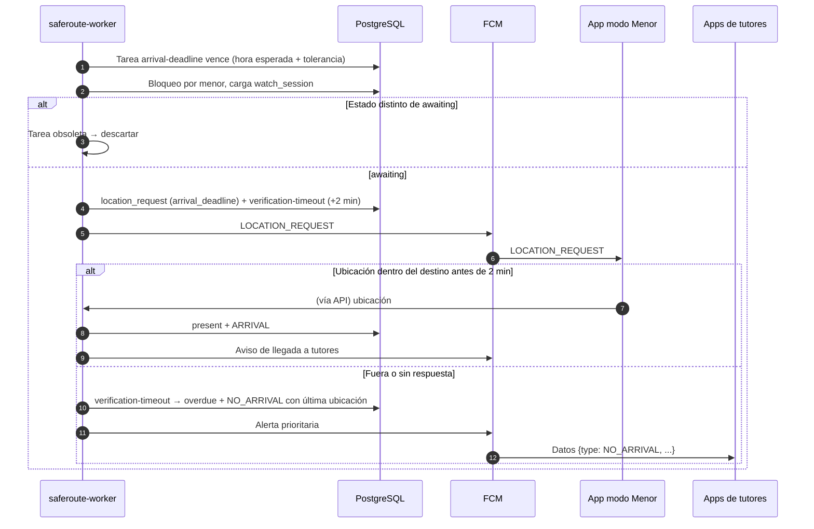

La alerta de no llegada se emite como máximo a hora esperada + tolerancia + 2 minutos (CA-05).

---

## 9. Flujo de verificación cada 20 minutos

### 9.1 Propósito

Las geocercas no son infalibles: Android puede retrasar o perder transiciones (ahorro de energía de fabricantes, geocercas eliminadas, GPS degradado en interiores). La verificación cada 20 minutos es una **red de seguridad del lado del servidor** (RF-044) que, mientras una sesión está abierta:

1. Confirma que el menor sigue en el destino y detecta salidas no reportadas (`present`).
2. Detecta llegadas no reportadas (`awaiting`, `overdue`).
3. Confirma el regreso (`away`).
4. Detecta dispositivos silenciosos y alimenta la alerta de sin conexión (RF-041).

Son como máximo 3 lecturas GPS por hora y solo durante ventanas de vigilancia.

### 9.2 Programación

- `window-opened` programa `verification-due` con instancia `{watchSessionId}:1` a `window_starts_at + 20 min`.
- Cada ciclo programa el siguiente a +20 min de la **hora planificada** del anterior, para no acumular retrasos.
- No se programa un ciclo posterior a `window_ends_at`.
- Una tarea cuyo ciclo no coincide con `watch_session.verification_cycle` se descarta.

### 9.3 Algoritmo del ciclo

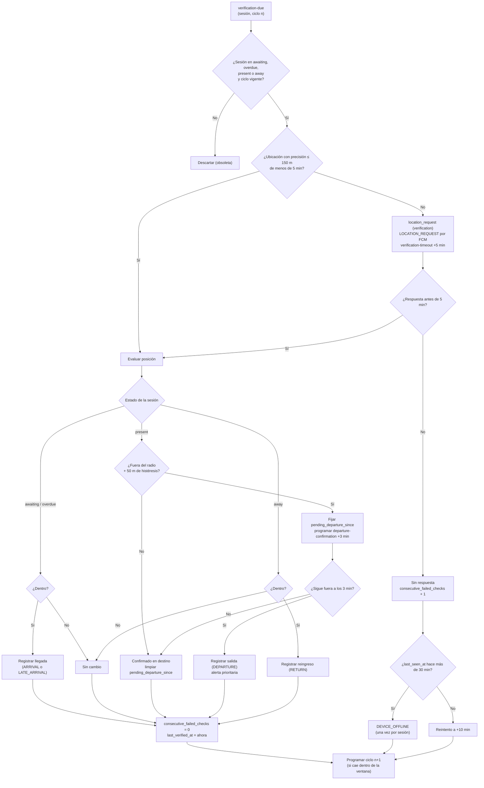

Reglas del algoritmo:

- **Reutilización de lecturas.** Una ubicación de calidad recibida en los últimos 5 minutos (evento, consulta del tutor, confirmación) se usa sin despertar al dispositivo.
- **Criterio "dentro".** El de la validación de llegada: `distancia ≤ radio + min(precisión, 50 m)`.
- **Criterio "fuera" para salida.** Más estricto: `distancia − precisión > radio + 50 m`, es decir, fuera aun en el caso más favorable de error del GPS. Una lectura ambigua no cuenta como salida.
- **Confirmación de salida.** `departure-confirmation` solicita una nueva lectura a los 3 minutos (coherente con RF-032). Si entretanto llega un `GEOFENCE_EXIT` confirmado por el dispositivo, la salida se registra por esa vía y la confirmación queda obsoleta.
- **Reintento por falta de respuesta.** Un ciclo sin respuesta programa un reintento a +10 min, de modo que la alerta de sin conexión se evalúa a los 30 minutos del último contacto y no a los 40 (RF-041). `DEVICE_OFFLINE` se emite una vez por sesión (`is_offline_alerted`); si el dispositivo vuelve a reportar, se emite `DEVICE_RECONNECTED`.
- **Tiempo máximo de detección de una salida no reportada:** 23 minutos (un ciclo de 20 + confirmación de 3), según CA-11.

### 9.4 Comportamiento en el dispositivo

Al recibir `LOCATION_REQUEST`:

1. `SafeRouteMessagingService.onMessageReceived` encola `LocationRequestWorker` *expedited* con el `locationRequestId`.
2. El worker solicita `getCurrentLocation(PRIORITY_HIGH_ACCURACY)` con 25 s de tiempo máximo y acepta una lectura en caché de hasta 60 s.
3. Envía `POST /device/locations` con posición, precisión, `isMock`, batería y permisos.
4. Sin red, encola la respuesta; si llega tarde, se usa para el historial y el ciclo siguiente, no para el ciclo vencido.

Los mensajes FCM de prioridad alta se entregan de inmediato incluso en Doze y permiten trabajo *expedited*. Android puede rebajar la prioridad de los mensajes de una app que no muestra notificaciones con ellos; las solicitudes de ubicación al menor se consideran legítimas por ser datos que disparan trabajo inmediato, y se monitorean con `saferoute.verification.outcome` por fabricante y modelo.

### 9.5 Costo estimado

| Concepto | Valor |
|---|---|
| Lecturas por sesión de 7 h | ≤ 21 (menos si hay lecturas reutilizables) |
| Tareas por sesión de 7 h | ~25 |
| Mensajes FCM al menor por día (2 sesiones) | ≤ 35 |
| Batería por lectura de alta precisión | 0,02–0,05 % |
| Batería de la verificación en un día escolar | 0,4–1,0 % (dentro de RNF-PER-03) |

Los valores de batería se validan en la prueba de campo.

---

## 10. Manejo de notificaciones

### 10.1 Principio: datos por FCM, texto en el dispositivo

FCM es gratuito y no tiene límite de mensajes, pero es un servicio de Google. Para cumplir RNF-PRI-07, el backend envía **solo mensajes de datos** sin nombres, direcciones ni coordenadas. La app construye la notificación visible con los datos de su caché local (nombres de menores y destinos sincronizados) y, si no los tiene, muestra un texto genérico y consulta el detalle al API.

```json
{
  "message": {
    "token": "<fcm-token>",
    "android": { "priority": "HIGH", "ttl": "3600s", "collapse_key": "0192b6b2:ARRIVAL" },
    "data": {
      "kind": "SAFETY_EVENT",
      "type": "ARRIVAL",
      "safetyEventId": "0192b6e1-...",
      "childId": "0192b6b2-...",
      "destinationId": "0192b6b5-...",
      "occurredAt": "2026-10-21T13:21:44Z"
    }
  }
}
```

### 10.2 Tipos de notificación

| Tipo | Destinatario | Canal Android | Prioridad FCM | Texto construido en la app |
|---|---|---|---|---|
| `ARRIVAL` | Tutores | `arrivals` | Alta | **Sofía llegó a Escuela** · 07:21 |
| `LATE_ARRIVAL` | Tutores | `alerts` | Alta | **Sofía llegó a Escuela** con retraso · 07:52 |
| `DEPARTURE` | Tutores | `priority_alerts` | Alta | **Sofía salió de Escuela** · 11:04. Toca para ver su ubicación. |
| `RETURN` | Tutores | `arrivals` | Alta | **Sofía regresó a Escuela** · 11:20 |
| `NO_ARRIVAL` | Tutores | `priority_alerts` | Alta | **Sofía no ha llegado a Escuela** (esperada 07:30). |
| `PERMISSION_REVOKED` | Tutores | `priority_alerts` | Alta | **SafeRoute no puede ver la ubicación de Sofía.** |
| `DEVICE_OFFLINE` | Tutores | `alerts` | Alta | **El teléfono de Sofía no responde** desde las 10:15. |
| `DEVICE_RECONNECTED` | Tutores | `device_status` | Normal | El teléfono de Sofía volvió a conectarse. |
| `BATTERY_LOW` | Tutores | `device_status` | Normal | **Batería baja en el teléfono de Sofía** (14 %). |
| `LOCATION_QUERY` | Otros tutores | Solo bandeja | — | Jorge consultó la ubicación de Sofía · 13:42 |
| `LOCATION_REQUEST` | Dispositivo del menor | Sin notificación visible | Alta | — |
| `CONFIG_CHANGED` | Dispositivo del menor | Sin notificación visible | Normal | — |

**Canales:**

| Canal | Importancia | Comportamiento |
|---|---|---|
| `arrivals` | Por defecto | Sonido estándar |
| `alerts` | Alta | Aviso emergente |
| `priority_alerts` | Alta | Sonido propio; `setBypassDnd(true)`, efectivo si el tutor concede acceso a "No molestar" (RF-054) |
| `device_status` | Baja | Sin sonido |

La hora se formatea en la zona horaria del destino. La notificación lleva un `PendingIntent` al detalle del evento (`saferoute://events/{safetyEventId}`).

### 10.3 Flujo de despacho

```mermaid
sequenceDiagram
    autonumber
    participant SVC as Servicio de dominio
    participant DB as PostgreSQL
    participant ND as Tarea dispatch-notification
    participant FCM as FCM HTTP v1
    participant T as App del tutor

    SVC->>DB: safety_event + notification (pending) por tutor + tarea (una transacción)
    ND->>DB: Recoge la tarea; si notification ya no está pending → descartar
    ND->>DB: Tokens activos del tutor
    loop Por cada token
        ND->>FCM: messages:send (Firebase Admin SDK)
        alt Éxito
            FCM-->>ND: messageId
        else UNREGISTERED / INVALID_ARGUMENT
            ND->>DB: guardian_push_token.invalidated_at = ahora
        else QUOTA_EXCEEDED / UNAVAILABLE / INTERNAL
            ND->>ND: Error transitorio → reintento de la tarea con espera exponencial
        end
    end
    ND->>DB: notification → sent (o failed tras agotar reintentos)
    FCM->>T: Mensaje de datos
    T->>T: NotificationRenderer construye y muestra la notificación
    T->>T: Toque → detalle del evento
```

### 10.4 Reglas de entrega

- **Una notificación por evento y tutor:** restricción única `(safety_event_id, guardian_id)` e instancia de tarea `{notificationId}`.
- **Preferencias:** por destino, si no global, si no el valor por defecto del catálogo. Si el tipo está desactivado, `status = skipped` y queda en la bandeja.
- **Reintentos:** errores transitorios de FCM con espera exponencial y circuit breaker de Resilience4j (apertura con 50 % de errores en 30 s).
- **Errores permanentes:** `UNREGISTERED` invalida el token; `INVALID_ARGUMENT` se registra como `ERROR` sin reintento.
- **Varios dispositivos por tutor:** se envía a todos los tokens activos.
- **Bandeja:** `GET /me/notifications` es la fuente de verdad; un push perdido sigue visible al abrir la app.
- **Latencia:** desde `occurredAt` (o `receivedAt` si fue diferido) hasta la aceptación de FCM, contra RNF-PER-01.

### 10.5 Gestión de tokens

- La app registra el token al iniciar sesión, al arrancar y en `onNewToken`.
- Al cerrar sesión lo elimina.
- `push-token-cleanup` invalida los tokens sin renovar en 60 días.
- En el dispositivo del menor, un token invalidado sin reemplazo durante una ventana activa es señal de desinstalación y contribuye a `DEVICE_OFFLINE`.

### 10.6 Ejecución sin FCM

El puerto `PushSender` tiene dos implementaciones, elegidas por la propiedad `saferoute.push.provider`:

| Valor | Implementación | Uso |
|---|---|---|
| `fcm` | `FcmPushSender` (Firebase Admin SDK) | QA, UAT, producción y desarrollo con proyecto Firebase propio |
| `log` | `LogPushSender`: registra el mensaje y lo marca como enviado | Desarrollo sin credenciales de Firebase; los eventos se ven en el historial y la bandeja |

---

## 11. Mapas y búsqueda de direcciones

### 11.1 Elección

Google Maps exige una cuenta de facturación y Mapbox SDK v10+ tiene licencia propietaria; ambos quedan fuera de RD-02. Se usa **OpenStreetMap** con componentes autoalojados:

| Necesidad | Componente | Licencia |
|---|---|---|
| Renderizado en la app | MapLibre Native Android | BSD-2-Clause |
| Teselas vectoriales | Mapa base de Protomaps en formato PMTiles, extracto de México | Software BSD-3; datos ODbL |
| Servidor de teselas | Martin (proyecto MapLibre), sirve PMTiles como teselas XYZ, glifos y sprites | Apache 2.0 / MIT |
| Estilo | Estilos del mapa base de Protomaps, fuentes Noto | BSD-3 / SIL OFL |
| Autocompletado y geocodificación inversa | Photon (Java) con índice de OpenStreetMap de México | Apache 2.0; datos ODbL |

### 11.2 Flujo

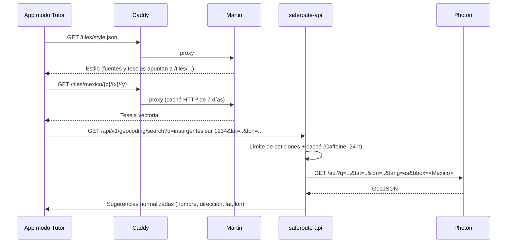

- La app no llama a Photon directamente: el API normaliza el contrato, aplica límites y caché, y permite cambiar de geocodificador sin publicar otra versión de la app.
- El círculo de la geocerca se dibuja en la app con una capa GeoJSON de MapLibre.

### 11.3 Datos y actualización

| Recurso | Fuente | Tamaño aproximado | Actualización |
|---|---|---|---|
| `mexico.pmtiles` | `pmtiles extract` sobre la compilación diaria de Protomaps con el *bounding box* de México | 1–2 GB | Mensual |
| `cdmx.pmtiles` (local) | Ídem con el *bounding box* de la Ciudad de México | 50–150 MB | Bajo demanda |
| Índice de Photon | Volcado por país (México) publicado por el proyecto Photon/GraphHopper, o importación propia desde un extracto `.osm.pbf` | Varios GB | Mensual |

### 11.4 Atribución

La licencia ODbL exige atribución: el mapa muestra siempre "© OpenStreetMap contributors" (control de atribución de MapLibre) y la pantalla de licencias lista OpenStreetMap, Protomaps y Photon (RNF-LIC-04).

### 11.5 Opción para desarrollo sin descargas pesadas

En `development` se puede usar, con volumen mínimo y respetando sus políticas de uso, la instancia pública de Photon (`photon.komoot.io`) y las teselas raster de `tile.openstreetmap.org` con un `User-Agent` identificable. **Están prohibidas en QA, UAT y producción**: sus políticas no admiten uso de producción. Se controlan con `saferoute.geocoding.base-url` y la URL del estilo en la configuración de la app por *build variant*.

---

## 12. Decisiones técnicas

| ID | Decisión | Alternativas consideradas | Motivo |
|---|---|---|---|
| ADR-001 | **App Android nativa en Java**, una sola app con modos Tutor y Menor. | Kotlin; React Native; Flutter; Codename One o Gluon para iOS. | Restricción RD-01. Java es lenguaje de primera clase en Android con las API de ubicación y FCM. Las herramientas Java para iOS son de pago o requieren el Apple Developer Program, por lo que iOS sale del MVP. |
| ADR-002 | **Android Views + Material Components** con MVVM. | Jetpack Compose. | Compose solo puede escribirse en Kotlin. |
| ADR-003 | **Java 25 LTS + Spring Boot 4** con Clean Architecture en Maven multimódulo. | Quarkus; Micronaut; Jakarta EE. | Ecosistema más amplio, Apache 2.0, soporte nativo de ProblemDetail (RFC 9457), integración directa con db-scheduler, Flyway, Micrometer y Spring Security. |
| ADR-004 | **Detección en el dispositivo, validación en el servidor.** | Envío continuo de ubicaciones. | Batería, datos y privacidad (§2.3). |
| ADR-005 | **Cola de tareas en PostgreSQL con db-scheduler**, sin broker. | RabbitMQ (MPL 2.0); Kafka (Apache 2.0); Quartz (Apache 2.0); JobRunr (versión Pro de pago). | Un solo componente con estado (PostgreSQL) simplifica la operación y el ambiente local. Las tareas se crean en la misma transacción (sin outbox aparte), admiten programación futura para los temporizadores y se reparten entre instancias con `SKIP LOCKED`. Si la carga lo exige, el puerto `TaskScheduler` permite introducir RabbitMQ. |
| ADR-006 | **PostgreSQL 18.** | SQL Server (Express limitada a 10 GB; Developer no admite producción); MySQL (GPL, propiedad de Oracle); MariaDB. | Licencia permisiva, sin límites, particionado declarativo, `uuidv7()`, `jsonb`, `SKIP LOCKED` y arreglos nativos. |
| ADR-007 | **FCM con mensajes solo de datos**; el texto se construye en la app. | ntfy o UnifiedPush autoalojados (Apache 2.0 / GPL). | FCM es gratuito, ilimitado y es el único canal que despierta de forma confiable una app Android en Doze. Las alternativas autoalojadas requieren conexión persistente y servicio en primer plano, con mayor consumo de batería. Enviar solo datos evita que el proveedor reciba datos personales (RNF-PRI-07). |
| ADR-008 | **OpenStreetMap autoalojado**: MapLibre + Martin + PMTiles de Protomaps + Photon. | Google Maps (requiere facturación); Mapbox (propietario); osmdroid (raster, menos fluido); Nominatim (sin autocompletado, GPL). | Sin costo ni licencia comercial; teselas vectoriales; Photon está escrito en Java y ofrece autocompletado. |
| ADR-009 | **Nombres en `snake_case`** en PostgreSQL, conservando los demás principios del estándar de base de datos de Ryndem (UUID, campos de control, restricciones con nombre, borrado lógico). | `camelCase` del estándar SQL Server de Ryndem. | PostgreSQL convierte a minúsculas los identificadores sin comillas; `camelCase` obligaría a entrecomillarlos en cada consulta. El estándar de Ryndem cubre SQL Server; se registra la adaptación en su buzón. |
| ADR-010 | **Borrado físico** al ejercer el derecho de cancelación y purga física de ubicaciones a 30 días. | Borrado lógico. | Obligación legal (LFPDPPP, derechos ARCO) y RNF-PRI-03. Excepción explícita; el resto de las bajas es lógico. Requiere validación legal. |
| ADR-011 | **Despliegue en contenedores** sobre Linux con Docker Engine o Podman, on-premise o VPS. | Nube administrada (Azure, AWS); Kubernetes. | Sin licencias de plataforma y la misma topología en local y en servidores. Docker Desktop requiere suscripción de pago en empresas de más de 250 empleados o más de 10 M USD de ingresos, por lo que se usa Docker Engine (Apache 2.0) en Linux o WSL2, o Podman. |
| ADR-012 | **Autenticación propia con JWT** (Spring Security + Nimbus) y Google como proveedor externo. | Keycloak (Apache 2.0). | Modelo de dos principales (tutor y dispositivo) con rotación de tokens del dispositivo, sin otro servicio que operar. Keycloak es la alternativa si se necesita federación o administración de identidades. |
| ADR-013 | **`java.time`** para zonas horarias y horarios. | Joda-Time. | Incluido en el JDK, con base IANA. |
| ADR-014 | **Verificación cada 20 minutos iniciada por el servidor** con FCM de prioridad alta. | Solo geocercas; ubicación periódica iniciada por el dispositivo. | Red de seguridad sin rastreo continuo; la cadencia no depende del mínimo de 15 min ni de los aplazamientos de WorkManager. |
| ADR-015 | **Versionado de API por ruta** (`/api/v1`) con versión mínima de app. | Encabezado; sin versionado. | Las versiones instaladas de la app conviven; política pendiente en los estándares de Ryndem. |
| ADR-016 | **Eclipse Temurin** como distribución del JDK en desarrollo, build e imágenes. | Oracle JDK. | Oracle JDK cambia a licencia comercial cuando su versión deja de ser la última LTS; Temurin es OpenJDK sin costo. |

---

## 13. Dependencias

Versiones exactas: se fijan al crear los proyectos (última estable con soporte) y se actualizan solo por obsolescencia, vulnerabilidad o funcionalidad necesaria.

### 13.1 Backend

| Dependencia | Uso | Licencia |
|---|---|---|
| Eclipse Temurin 25 (JDK/JRE) | Plataforma | GPLv2 + Classpath Exception |
| Spring Boot 4 (Web MVC, Validation, Data JPA, Security, OAuth2 Resource Server, Actuator, Mail) | Framework | Apache 2.0 |
| Hibernate ORM 7, Hibernate Validator | JPA y validación | Apache 2.0 |
| PostgreSQL JDBC | Controlador | BSD-2-Clause |
| HikariCP | Pool de conexiones | Apache 2.0 |
| Flyway Community | Migraciones | Apache 2.0 |
| db-scheduler + db-scheduler-spring-boot-starter | Tareas persistidas | Apache 2.0 |
| MapStruct | Mapeo entidad ↔ dominio ↔ DTO | Apache 2.0 |
| Nimbus JOSE + JWT | Firma de JWT | Apache 2.0 |
| BouncyCastle | Argon2id | MIT |
| google-api-client | Verificación de ID token de Google | Apache 2.0 |
| Firebase Admin SDK for Java | FCM HTTP v1 | Apache 2.0 |
| Resilience4j | Reintentos y circuit breaker | Apache 2.0 |
| Bucket4j (+ módulo PostgreSQL) | Límite de peticiones | Apache 2.0 |
| Caffeine | Caché en memoria | Apache 2.0 |
| springdoc-openapi | OpenAPI y Swagger UI | Apache 2.0 |
| Micrometer + registry Prometheus | Métricas | Apache 2.0 |
| Logback | Logging | EPL 1.0 / LGPL 2.1 |
| logstash-logback-encoder | Logs JSON | Apache 2.0 |
| JUnit 5 | Pruebas | EPL 2.0 |
| Mockito | Dobles de prueba | MIT |
| AssertJ | Aserciones | Apache 2.0 |
| ArchUnit | Reglas de arquitectura | Apache 2.0 |
| Testcontainers (PostgreSQL) | Integración | MIT |
| Spotless + google-java-format | Formato | Apache 2.0 |
| CycloneDX Maven Plugin | SBOM e inventario de licencias | Apache 2.0 |
| OWASP Dependency-Check | Vulnerabilidades | Apache 2.0 |

### 13.2 App Android

| Dependencia | Uso | Licencia |
|---|---|---|
| Android SDK, Android Gradle Plugin, Android Studio | Plataforma y build | Términos del Android SDK (gratuito) / Apache 2.0 |
| AndroidX (AppCompat, Fragment, Lifecycle, Navigation, Room, WorkManager, Credentials) | Base | Apache 2.0 |
| Material Components for Android | Interfaz | Apache 2.0 |
| Hilt (Dagger) | Inyección de dependencias | Apache 2.0 |
| Retrofit, OkHttp, Moshi | Red | Apache 2.0 |
| Google Play Services Location | Geocercas y ubicación | Propietario, gratuito |
| Firebase Cloud Messaging (Firebase BoM) | Push | Propietario, gratuito |
| Google Identity Services (`googleid`) | Inicio de sesión con Google | Propietario, gratuito |
| MapLibre Native Android | Mapas | BSD-2-Clause |
| ZXing Android Embedded | Escaneo de QR | Apache 2.0 |
| Tink for Android | Cifrado de tokens con Keystore | Apache 2.0 |
| AboutLibraries | Pantalla de licencias de código abierto | Apache 2.0 |
| ACRA | Reporte de fallos hacia el backend propio | Apache 2.0 |
| JUnit 4, Mockito, Robolectric | Pruebas unitarias | EPL 1.0 / MIT / MIT |
| Espresso, AndroidX Test | Pruebas instrumentadas | Apache 2.0 |
| Maestro CLI | Pruebas de extremo a extremo | Apache 2.0 |
| Checkstyle | Estilo | LGPL 2.1 (herramienta de build, no se distribuye) |
| CycloneDX Gradle Plugin | SBOM | Apache 2.0 |

Para el reporte de fallos (RNF-FIA-05) se usa ACRA, que envía los informes a un endpoint propio (`POST /api/v1/crash-reports`, sin datos personales), en lugar de Firebase Crashlytics, para no enviar más telemetría a terceros.

### 13.3 Servicios e infraestructura

| Componente | Uso | Licencia / costo |
|---|---|---|
| PostgreSQL 18 | Base de datos | PostgreSQL License |
| pgBackRest | Respaldos y archivado WAL | MIT |
| Caddy | Proxy inverso, TLS automático | Apache 2.0 |
| Let's Encrypt | Certificados TLS | Gratuito |
| Martin | Servidor de teselas | Apache 2.0 / MIT |
| Photon | Geocodificador | Apache 2.0 |
| PMTiles CLI | Extracción de teselas | BSD-3-Clause |
| Prometheus | Métricas | Apache 2.0 |
| Grafana, Loki | Paneles y logs | AGPL-3.0 (uso sin modificar) |
| OpenBao | Bóveda de secretos en servidores | MPL 2.0 |
| Mailpit | Servidor SMTP de pruebas en local | MIT |
| Docker Engine / Podman | Contenedores | Apache 2.0 |
| Firebase (plan Spark) | FCM | Gratuito |
| Google Cloud (cliente OAuth) | Inicio de sesión con Google | Gratuito |
| Google Play Console | Publicación | Cuota única de registro (no es licencia; no se requiere para pruebas locales) |

---

## 14. Análisis de licenciamiento

### 14.1 Criterios

| Categoría | Criterio | Ejemplos |
|---|---|---|
| **Permitida** | Licencia OSI permisiva: Apache 2.0, MIT, BSD, PostgreSQL, EPL, MPL 2.0 | Spring Boot, PostgreSQL, MapLibre, Photon |
| **Permitida con condiciones** | Copyleft usado como servicio separado y sin modificar (GPL, AGPL), o de herramientas de build que no se distribuyen (LGPL) | Grafana, Loki (AGPL); Checkstyle (LGPL) |
| **Permitida con condiciones** | Servicio o SDK propietario **gratuito**, sin cuota de licencia ni de uso en el volumen del MVP | FCM, Google Play Services Location, Google Identity Services |
| **No permitida** | Licencias de pago por uso comercial, *source-available* (BSL, FSL, SSPL, RSAL), SDK que exigen facturación | Oracle JDK fuera de su periodo gratuito, Docker Desktop en empresa grande, HashiCorp Vault (BSL), Liquibase 5+ (FSL), Redis 7.4+ (RSAL/SSPL), Elasticsearch (SSPL/ELv2), Google Maps SDK, Mapbox SDK v10+, JobRunr Pro |

### 14.2 Inventario por capa

| Capa | Componente | Licencia | Categoría | Obligaciones |
|---|---|---|---|---|
| Lenguaje | Eclipse Temurin (OpenJDK) | GPLv2 + CPE | Permitida | La excepción de enlace permite distribuir aplicaciones sin efecto copyleft. |
| Backend | Spring Boot y ecosistema | Apache 2.0 | Permitida | Conservar avisos `NOTICE` en las imágenes. |
| Backend | Hibernate ORM 7 | Apache 2.0 | Permitida | — |
| Backend | Logback | EPL 1.0 / LGPL 2.1 | Permitida | Uso como librería sin modificar. |
| Base de datos | PostgreSQL | PostgreSQL License | Permitida | — |
| Tareas | db-scheduler | Apache 2.0 | Permitida | — |
| Migraciones | Flyway Community | Apache 2.0 | Permitida | No usar funciones de las ediciones Teams/Enterprise. |
| App | AndroidX, Material, Hilt, Retrofit, OkHttp, Room, WorkManager, Tink, ZXing | Apache 2.0 | Permitida | Mostrar licencias en la app (AboutLibraries). |
| App | MapLibre Native Android | BSD-2 | Permitida | Aviso de copyright en la pantalla de licencias. |
| App | Google Play Services Location | Propietario gratuito | Con condiciones | Términos de las API de Google; dependencia de Google (R-15). |
| Notificaciones | Firebase Cloud Messaging | Propietario gratuito | Con condiciones | Términos de Firebase; declarar a Google como encargado en el aviso de privacidad; no enviar datos personales (ADR-007). |
| Identidad | Google Identity Services | Propietario gratuito | Con condiciones | Política de datos de usuario de las API de Google. |
| Mapas | Datos de OpenStreetMap | ODbL 1.0 | Con condiciones | Atribución visible "© OpenStreetMap contributors"; si se distribuye una base derivada, compartirla bajo ODbL (no aplica al uso como teselas). |
| Mapas | Protomaps basemap, PMTiles | BSD-3 | Permitida | Atribución a Protomaps. |
| Mapas | Martin | Apache 2.0 / MIT | Permitida | — |
| Mapas | Fuentes Noto | SIL OFL 1.1 | Permitida | — |
| Geocodificación | Photon | Apache 2.0 | Permitida | Datos ODbL: atribución. |
| Observabilidad | Prometheus | Apache 2.0 | Permitida | — |
| Observabilidad | Grafana, Loki | AGPL-3.0 | Con condiciones | Uso interno sin modificar; si se modificaran y ofrecieran a terceros por red, habría que publicar los cambios. |
| Secretos | OpenBao | MPL 2.0 | Permitida | — |
| Contenedores | Docker Engine, Podman | Apache 2.0 | Permitida | **No usar Docker Desktop** salvo que la organización califique para su uso gratuito. |
| Herramientas | Android Studio, Android SDK | Términos del SDK (gratuito) | Con condiciones | Aceptar los términos del SDK. |
| Herramientas | Maestro CLI | Apache 2.0 | Permitida | No usar Maestro Cloud (de pago). |

### 14.3 Componentes excluidos y su sustituto

| Excluido | Motivo | Sustituto |
|---|---|---|
| Google Maps SDK / Places API | Requiere cuenta de facturación | MapLibre + Martin + Photon |
| Mapbox SDK v10+ | Licencia propietaria con cuota | MapLibre Native |
| Oracle JDK | Licencia comercial fuera del periodo gratuito | Eclipse Temurin |
| Docker Desktop | Suscripción en empresas grandes | Docker Engine en WSL2/Linux, Podman |
| SQL Server Standard/Enterprise | Licencia por núcleo | PostgreSQL |
| Azure Service Bus, Azure SQL, App Service | Servicios de pago | db-scheduler sobre PostgreSQL, contenedores propios |
| HashiCorp Vault | BSL 1.1 | OpenBao |
| Liquibase 5+ | FSL | Flyway Community |
| Elasticsearch | SSPL / ELv2 | OpenSearch embebido en Photon (Apache 2.0) |
| Firebase Crashlytics | Gratuito, pero envía telemetría a terceros | ACRA hacia backend propio |
| Apple Developer Program (iOS) | Cuota anual | iOS fuera del MVP (PA-07) |
| `react-native-background-geolocation` | Licencia comercial para Android | Google Play Services Location en Java |

### 14.4 Verificación automática

Según el principio de Ryndem "lo verificable vence a lo documentado", el cumplimiento se comprueba en el pipeline:

1. **SBOM**: CycloneDX genera la lista de materiales del backend (Maven) y de la app (Gradle) en cada build.
2. **Lista de licencias permitidas**: un paso del pipeline compara las licencias del SBOM con la lista de §14.1 y **falla** si aparece una licencia no permitida o desconocida. Las excepciones (SDK gratuitos de Google) se declaran por coordenada en un archivo versionado `licenses-allowlist.json`.
3. **Imágenes de contenedor**: se usan solo imágenes base de código abierto (`eclipse-temurin`, `postgres`, `caddy`, Martin, Photon construida desde el JAR oficial).
4. **Pantalla de licencias**: AboutLibraries se genera desde las dependencias reales del build.

---

## 15. Ejecución en ambiente local

### 15.1 Requisitos del equipo

| Herramienta | Versión | Licencia |
|---|---|---|
| Linux o Windows 11 con WSL2 | — | — |
| Docker Engine con Compose v2 (dentro de WSL2 o Linux), o Podman con `podman compose` | Última estable | Apache 2.0 |
| Eclipse Temurin JDK | 25 (backend) y 17+ (Android Gradle) | GPLv2 + CPE |
| Maven | 3.9+ (o el *wrapper* `mvnw` incluido) | Apache 2.0 |
| Android Studio con imagen de emulador **"Google Play"** (API 34 o superior) | Última estable | Gratuito |
| Git | — | GPL-2.0 |

Opcional: proyecto Firebase gratuito (plan Spark) para recibir push reales en el emulador. Sin él, el backend usa `saferoute.push.provider=log` (§10.6).

### 15.2 Servicios del ambiente local

```yaml
# deploy/local/compose.yaml (extracto)
services:
  postgres:
    image: postgres:18
    environment:
      POSTGRES_DB: saferoute
      POSTGRES_USER: saferoute
      POSTGRES_PASSWORD: saferoute-local   # solo para desarrollo local
    ports: ["5432:5432"]
    volumes: [pgdata:/var/lib/postgresql]

  api:
    build: ../../backend/saferoute-api
    environment:
      SPRING_PROFILES_ACTIVE: development
      SAFEROUTE_PUSH_PROVIDER: ${SAFEROUTE_PUSH_PROVIDER:-log}
      SAFEROUTE_GEOCODING_BASE_URL: http://photon:2322
    ports: ["8080:8080"]
    depends_on: [postgres]

  worker:
    build: ../../backend/saferoute-worker
    environment:
      SPRING_PROFILES_ACTIVE: development
      SAFEROUTE_PUSH_PROVIDER: ${SAFEROUTE_PUSH_PROVIDER:-log}
    depends_on: [postgres]

  martin:
    image: ghcr.io/maplibre/martin
    command: ["/data/cdmx.pmtiles", "--font", "/fonts", "--sprite", "/sprites"]
    volumes: ["./data/maps:/data", "./data/fonts:/fonts", "./data/sprites:/sprites"]
    ports: ["3000:3000"]

  photon:
    build: ./photon          # Dockerfile que descarga el JAR oficial de Photon
    volumes: ["./data/photon:/photon/photon_data"]
    ports: ["2322:2322"]
    profiles: ["geo"]        # opcional: requiere el índice de México

  mailpit:
    image: axllent/mailpit
    ports: ["8025:8025", "1025:1025"]

  prometheus:
    image: prom/prometheus
    profiles: ["observability"]
  grafana:
    image: grafana/grafana-oss
    profiles: ["observability"]

volumes:
  pgdata:
```

Las versiones de imagen se fijan por etiqueta exacta en el archivo real. Las credenciales locales son de desarrollo y no se reutilizan en otros ambientes; los secretos de QA, UAT y producción viven en OpenBao.

### 15.3 Pasos

1. **Clonar** el repositorio.
2. **Datos de mapas (una vez):** ejecutar `deploy/local/scripts/fetch-map-data.sh`, que descarga con `pmtiles extract` el extracto de la Ciudad de México, las fuentes y los sprites en `deploy/local/data/`. Opcional: `fetch-photon-index.sh` para el índice de Photon.
3. **Arrancar el backend:** `docker compose -f deploy/local/compose.yaml up -d` (o `--profile geo --profile observability` para los servicios opcionales). Flyway crea el esquema al arrancar el API.
4. **Datos de prueba:** `deploy/local/scripts/seed.sh` crea un tutor (`tutor@saferoute.local` / contraseña de desarrollo), un menor, un destino "Escuela de prueba" con ventana desde la hora actual y un código de vinculación impreso en consola.
5. **App:** abrir `android/` en Android Studio y ejecutar la variante `localDebug` en un emulador con Google Play. Esta variante apunta a `http://10.0.2.2:8080` y a `http://10.0.2.2:3000` para teselas, y permite tráfico sin TLS solo en esa variante (`network_security_config`).
6. **Push real (opcional):** colocar `google-services.json` del proyecto Firebase de desarrollo en `android/app/src/localDebug/` y la cuenta de servicio en `deploy/local/secrets/firebase.json`, y arrancar con `SAFEROUTE_PUSH_PROVIDER=fcm`.
7. **Correo:** los correos de verificación y recuperación se ven en Mailpit (`http://localhost:8025`).
8. **Documentación de API:** Swagger UI en `http://localhost:8080/swagger-ui.html`.

**Red en WSL2.** Con el backend en WSL2 y el emulador en Windows, el emulador alcanza el host con `10.0.2.2`, y Windows reenvía `localhost` a WSL2 (comportamiento por defecto; con el modo de red `mirrored` de WSL2 también funciona). Si se usa un dispositivo físico, se conecta por `adb reverse tcp:8080 tcp:8080` y `adb reverse tcp:3000 tcp:3000`.

### 15.4 Escenarios reproducibles

Los escenarios usan ubicación simulada del emulador (`adb emu geo fix <lon> <lat>` o rutas GPX desde los controles extendidos) y se automatizan en `deploy/local/scenarios/`:

| Escenario | Pasos | Resultado esperado |
|---|---|---|
| Llegada | Vincular el emulador como menor; ubicar fuera del destino; mover al centro del destino y esperar 60–90 s. | `ARRIVAL` en el historial; push o registro en el log del Worker. |
| Salida | Tras la llegada, mover a 300 m del borde y esperar 3–4 min. | `DEPARTURE`. |
| Salida no reportada (RF-044) | Tras la llegada, desactivar las geocercas con la opción de depuración "Desactivar geocercas" y mover fuera. | `DEPARTURE` en el siguiente ciclo de verificación + 3 min. Para acelerar, el perfil `development` admite `saferoute.verification.interval=PT2M`. |
| No llegada | Destino con hora esperada = ahora + 2 min y tolerancia mínima; mantener fuera. | `NO_ARRIVAL` al vencer el plazo + 2 min. |
| Sin conexión | Tras la llegada, activar el modo avión del emulador. | `DEVICE_OFFLINE` a los 30 min (o al intervalo reducido en `development`). |
| Permiso revocado | Cambiar el permiso de ubicación a "Solo mientras se usa la app". | `PERMISSION_REVOKED`. |
| Evento diferido | Activar modo avión, entrar al destino, esperar, desactivar modo avión. | `ARRIVAL` con la hora real de entrada. |

Los intervalos (verificación, tolerancia mínima, sin conexión) son configurables solo en el perfil `development`, para que las pruebas locales no tarden 20 o 30 minutos; en los demás perfiles se fijan los valores del PRD.

### 15.5 Pruebas automatizadas en local

| Comando | Qué ejecuta |
|---|---|
| `./mvnw verify` (en `backend/`) | Pruebas unitarias, ArchUnit, integración con Testcontainers (PostgreSQL real en contenedor), cobertura, SBOM y verificación de licencias |
| `./gradlew testLocalDebugUnitTest` (en `android/`) | Pruebas unitarias JVM y Robolectric |
| `./gradlew connectedLocalDebugAndroidTest` | Pruebas instrumentadas en el emulador |
| `maestro test e2e/` | Flujos de extremo a extremo del tutor contra el backend local |

---

## 16. Estándares de desarrollo

SafeRoute se desarrolla bajo los **estándares de Ryndem** (v0.63.2). Ryndem no tiene aún capítulos de stack para Java, Android ni PostgreSQL; por eso aplican completas las **políticas transversales** (`core/engineering` y `core/process`) y, de los capítulos de stack existentes, los principios que no dependen de la tecnología. Las adaptaciones se registran como propuesta en el buzón de estándares.

### 16.1 Alta del repositorio

Antes del primer desarrollo se ejecuta `/ryndem-standards:adopt` declarando `class: product`, `language.default: en` y los stacks del proyecto, señalando que Java, Android y PostgreSQL no tienen capítulo propio.

### 16.2 Principios aplicables

- Orden de prioridad: correcto, legible, simple, explícito, consistente con el código circundante.
- SOLID, DRY (tres ocurrencias antes de abstraer) y KISS.
- Lo verificable vence a lo documentado: ArchUnit para capas, prueba de unicidad del catálogo de errores, verificación de licencias en el pipeline, Spotless y Checkstyle en el build.
- Deuda técnica declarada: todo `TODO` o `FIXME` con ticket.

### 16.3 Idioma y nombrado

| Elemento | Idioma |
|---|---|
| Identificadores (Java, SQL, recursos de Android), rutas de API, DTOs, propiedades JSON | Inglés |
| Comentarios, Javadoc, mensajes de log, textos al usuario | Español |
| Prosa de los nombres de prueba (escenario y resultado) | Español |
| Documentación OpenAPI y campos del catálogo que viajan al cliente | Inglés |

Nunca se mezclan idiomas en un identificador.

### 16.4 Java (backend y Android)

- Estilo de Google Java Style, aplicado con Spotless (`google-java-format`) y Checkstyle; el build falla si no se cumple.
- Clases y records `PascalCase`; métodos y variables `camelCase`; constantes `UPPER_SNAKE_CASE`; paquetes en minúsculas.
- DTOs como `record` inmutables; `Optional` solo como tipo de retorno.
- Anotaciones de nulabilidad JSpecify (`@NullMarked` por paquete).
- `java.time.Clock` inyectado: ninguna lógica usa `Instant.now()`, `LocalDateTime.now()` ni `System.currentTimeMillis()` directamente.
- Configuración con `@ConfigurationProperties` validadas al arrancar; ninguna lectura de claves sueltas.
- Controllers y manejadores de tareas sin reglas de negocio ni `try/catch` para traducir errores.
- Modelo de errores de §4.9.
- En Android: sin trabajo en el hilo principal (StrictMode activo en `debug`), sin `Log` en `release` (reglas de R8), y recursos de cadenas en español para todo texto visible.

### 16.5 Base de datos

- Convenciones de §6.1.
- Toda modificación de esquema por migración Flyway, revisada en el PR; nunca cambios manuales en ambientes.
- Restricciones `CHECK` para las invariantes del dato.
- Sin reglas de negocio en funciones o *triggers*.

### 16.6 Pruebas

| Nivel | Alcance | Herramienta |
|---|---|---|
| Unitarias backend | `GeofenceEvaluator`, `ScheduleWindow`, `WatchSessionStateMachine`, servicios, validadores, catálogo | JUnit 5, Mockito, AssertJ |
| Arquitectura | Dependencias entre módulos y paquetes | ArchUnit |
| Integración backend | Repositorios, tareas db-scheduler, migraciones | Testcontainers |
| Unitarias Android | View models, repositorios, `NotificationRenderer`, lógica de geocercas con `GeofencingClient` simulado | JUnit 4, Mockito, Robolectric |
| Instrumentadas | Flujos de pantalla | Espresso |
| Extremo a extremo | Flujos del tutor contra el backend local | Maestro CLI |
| Campo | Detección real, batería, verificación de 20 min, por fabricante | Piloto (CA-10) |

Reglas:

- Nombre de prueba `<unidad>_<escenario>_<resultado>`: la unidad es el identificador verbatim y el escenario y el resultado van en español en `camelCase` (p. ej., `isInside_precisionMayorAlMargen_usaMargenMaximo`). `@DisplayName` opcional en español natural.
- Cobertura ≥ 80 % en `domain/rule` (RNF-MAN-01), exigida con JaCoCo (EPL 2.0) en el build.
- Toda corrección de defecto llega con una prueba que fallaba antes.
- Reloj y zona horaria controlados en toda prueba de horarios, incluido el cambio de horario de verano.
- Ninguna prueba unitaria toca la base de datos real; las de integración usan Testcontainers.

### 16.7 Seguridad

- Ningún secreto en el repositorio: en local, archivos en `deploy/local/secrets/` excluidos por `.gitignore` y plantillas `.example`; en servidores, OpenBao.
- Validación de toda entrada en el borde (Bean Validation) y autorización por operación en el servidor (§4.8).
- *Certificate pinning* en las variantes de QA, UAT y producción (RNF-SEG-01), con pin actual y de respaldo; desactivado en `localDebug`.
- OWASP Dependency-Check en el pipeline; una vulnerabilidad conocida bloquea.
- Revisión OWASP MASVS L1 antes del lanzamiento (RNF-SEG-09).

### 16.8 Proceso

- Ramas, tipos de cambio, formato de commit con scope del requisito, Pull Requests con labels y Definition of Done según `ryndem-process`.
- SemVer derivado de los commits; la app publica `versionName` SemVer y `versionCode` incremental.
- Pipeline de CI con herramientas libres (p. ej., Gitea Actions o Jenkins, ambos MIT, o el CI incluido en la plataforma de repositorios de Ryndem): compilación, Spotless, Checkstyle, pruebas, cobertura, ArchUnit, SBOM, verificación de licencias, Dependency-Check y build del APK.

---

## 17. Trazabilidad con el PRD

| Funcionalidad o requerimiento | Diseño |
|---|---|
| F-01 Cuenta | §4.8, §7.2, §7.3 |
| F-02 Grupo familiar | §6.3, §7.4 |
| F-03 Vinculación | §5.3, §5.5, §7.5, §7.8 |
| F-04 Destinos | §4.6, §6.3, §7.6, §11 |
| F-05 Llegada | §4.5, §8 |
| F-06 Salida | §4.5, §5.5, §9.3 |
| F-07 No llegada | §8.5 |
| F-08 Estado del dispositivo | §5.5, §9.3, §10.5 |
| F-09 Ubicación bajo demanda | §7.7, §9.4 |
| F-10 Historial | §6.3, §7.7 |
| F-11 Preferencias | §10.2, §10.4 |
| F-12 Privacidad | §4.12, §7.9, ADR-010 |
| RF-044 Verificación periódica | §9 |
| RNF-PER-01 | §4.11, §10.4 |
| RNF-PER-03 | §5.5, §9.5 |
| RNF-FIA-04 | §4.7 |
| RNF-SEG-* | §4.8, §16.7 |
| RNF-PRI-03, RNF-PRI-04 | §2.3, §4.12 |
| RNF-PRI-07 | §10.1, ADR-007 |
| RNF-LIC-01 – RNF-LIC-04 | §13, §14 |
| RNF-OPE-01 – RNF-OPE-03 | §15 |

---

## 18. Riesgos técnicos y preguntas abiertas

### 18.1 Riesgos técnicos

| ID | Riesgo | Mitigación en el diseño |
|---|---|---|
| RT-01 | Capas de ahorro de energía de fabricantes Android terminan procesos o eliminan geocercas. | Reregistro en todos los disparadores conocidos (§5.5); guía por fabricante; verificación del servidor (§9); métricas por fabricante y modelo. |
| RT-02 | Android rebaja la prioridad de los mensajes FCM de alta prioridad que no muestran notificación. | Monitorear `saferoute.verification.outcome`; si se degrada, mostrar una notificación silenciosa de baja importancia al responder la verificación. |
| RT-03 | La cola de tareas en PostgreSQL se convierte en cuello de botella. | Pruebas de carga con 10× el promedio; índices de db-scheduler; puerto `TaskScheduler` para migrar a RabbitMQ. |
| RT-04 | Ubicaciones simuladas por el menor. | `isMock` registrado y comunicado en la notificación. |
| RT-05 | Crecimiento de `location_sample` y `device_event`. | Particionado mensual desde el inicio y purga por partición. |
| RT-06 | Recursos de servidor para Photon y teselas (memoria y disco). | Extracto solo de México; Photon con ~4–8 GB de RAM; caché HTTP de teselas en Caddy. |
| RT-07 | Dependencia de servicios gratuitos de Google (FCM, Play Services) cuyas condiciones pueden cambiar. | Puertos `PushSender` y encapsulamiento de la ubicación en `core/location`; alternativas documentadas (ADR-007). |
| RT-08 | Ausencia de estándares de Ryndem para Java, Android y PostgreSQL. | Convenciones de §16 explícitas y verificables; propuesta al buzón de estándares. |

### 18.2 Preguntas abiertas

| ID | Pregunta | Responsable |
|---|---|---|
| PT-01 | ¿Dónde se aloja el ambiente de QA/UAT/producción (servidores on-premise de Ryndem con Linux o VPS)? | Infraestructura |
| PT-02 | ¿La organización califica para el uso gratuito de Docker Desktop, o se estandariza Docker Engine en WSL2 / Podman? | Infraestructura |
| PT-03 | ¿El intervalo de 20 minutos es fijo o configurable por destino? | Producto |
| PT-04 | ¿Se confirma OpenBao como bóveda de secretos? | Infraestructura |
| PT-05 | ¿La verificación de 20 minutos aplica desde la apertura de la ventana o solo desde la hora esperada? (Diseño actual: desde la apertura.) | Producto |
| PT-06 | Dominio definitivo del API, del enlace profundo de invitaciones y del paquete Java. | Producto |
| PT-07 | Validación legal del borrado físico (ADR-010), del consentimiento del menor (PA-01) y de la declaración de Google como encargado (FCM). | Legal |
| PT-08 | Plataforma de CI disponible en Ryndem para proyectos Java y Android. | Infraestructura |
